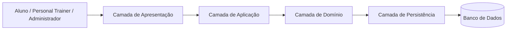
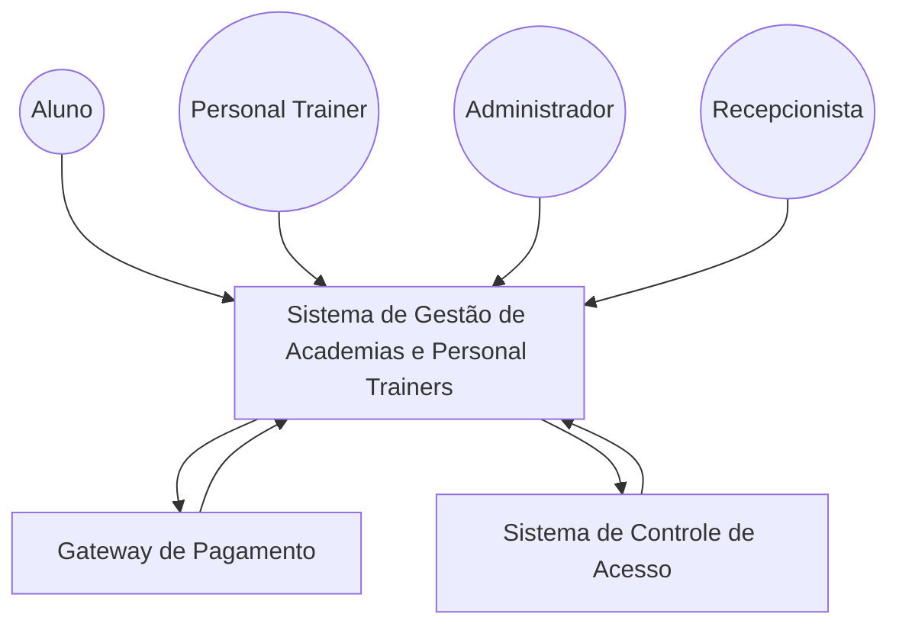
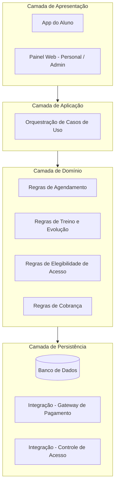
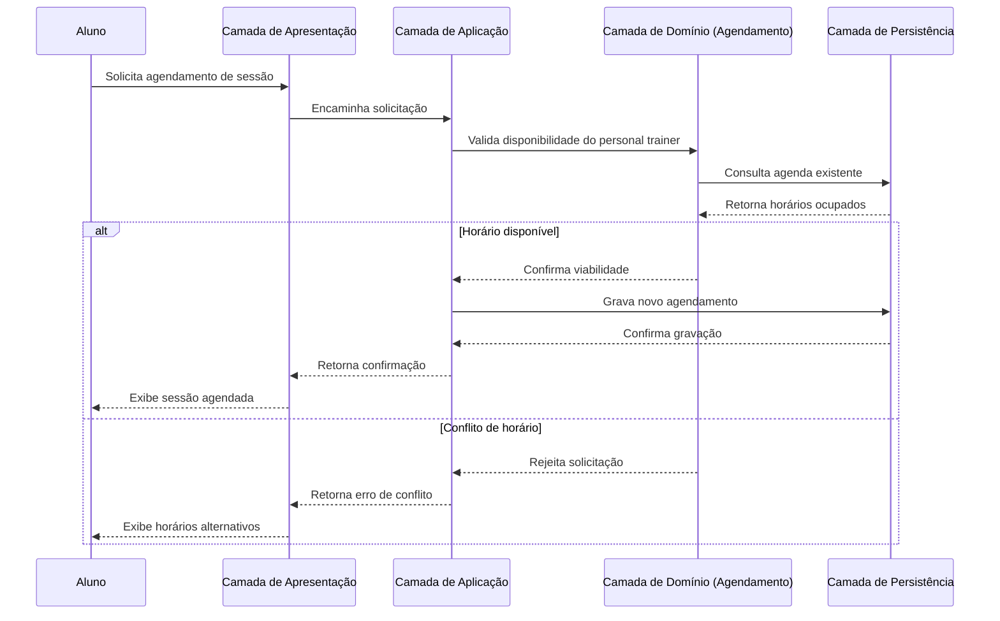
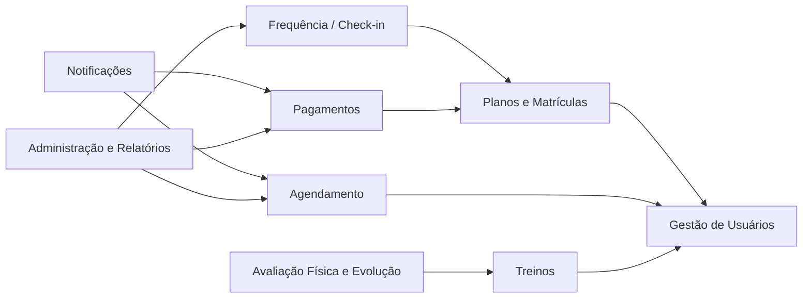

# Proposta de Arquitetura de Software
## Sistema de Gestão de Academias e Personal Trainers

**Grupo:** [Nome do Grupo]
**Integrantes:** [Integrante 1], [Integrante 2], [Integrante 3]
**Tema escolhido:** Sistema de gestão de academias e personal trainers
**Disciplina:** Arquitetura de Software
**Data:** [DD/MM/AAAA]

---

## 1. Introdução e Descrição do Problema

Academias e personal trainers autônomos costumam depender de planilhas, aplicativos de mensagem e cadernos de anotações para controlar matrículas, planos de treino, agendamentos e pagamentos. Essa fragmentação gera retrabalho, perda de histórico de evolução física dos alunos, dificuldade para o professor acompanhar múltiplos alunos simultaneamente e falta de visibilidade gerencial para o dono da academia sobre frequência, inadimplência e ocupação dos horários.

O **Sistema de Gestão de Academias e Personal Trainers** resolve esse problema ao centralizar, em uma única plataforma, o cadastro de alunos, a montagem e o acompanhamento de planos de treino personalizados, o agendamento de sessões com personal trainers, o controle de acesso/frequência e a gestão financeira das mensalidades.

O contexto de uso real envolve academias de pequeno e médio porte, studios de treinamento funcional e personal trainers autônomos que atendem tanto dentro de academias parceiras quanto em domicílio. A plataforma precisa, portanto, funcionar tanto como um sistema de retaguarda para o negócio (gestão de planos, pagamentos, acesso) quanto como uma ferramenta de relacionamento diário entre aluno e profissional (treinos, agendamentos, evolução física).

## 2. Identificação dos Atores

| Ator | Papel | Interação com o sistema |
|---|---|---|
| **Aluno** | Consumidor final do serviço | Consulta seu plano de treino, agenda sessões com o personal trainer, faz check-in na academia, acompanha sua evolução física e realiza pagamentos |
| **Personal Trainer** | Prestador de serviço (interno ou autônomo) | Monta e ajusta planos de treino, gerencia sua agenda de atendimentos, registra avaliações físicas dos alunos |
| **Administrador da Academia** | Gestor do negócio | Cadastra planos, acompanha relatórios financeiros e de frequência, gerencia contratos com personal trainers |
| **Recepcionista** | Atendimento presencial | Realiza matrícula presencial, emite recibos, auxilia no check-in de alunos sem aplicativo |
| **Gateway de Pagamento** *(sistema externo)* | Parceiro de cobrança | Processa cobranças recorrentes de mensalidade e repassa confirmações ao sistema |
| **Sistema de Controle de Acesso** *(sistema externo)* | Hardware de catraca/biometria | Libera ou nega a entrada física do aluno com base no status da matrícula |

## 3. Módulos do Sistema

| Módulo | Responsabilidade |
|---|---|
| **Gestão de Usuários** | Cadastro, autenticação e perfis de alunos, personal trainers e administradores |
| **Planos e Matrículas** | Definição de planos de assinatura, contratação, upgrade/downgrade e cancelamento |
| **Agendamento** | Marcação de sessões com personal trainers e aulas em grupo, respeitando disponibilidade e capacidade |
| **Treinos** | Criação, edição e versionamento de planos de treino personalizados |
| **Avaliação Física e Evolução** | Registro de medidas corporais, metas e progresso do aluno ao longo do tempo |
| **Frequência / Check-in** | Controle de entrada e saída, integração com catraca/biometria |
| **Pagamentos** | Cobrança recorrente de mensalidade, integração com gateway de pagamento, controle de inadimplência |
| **Notificações** | Lembretes de sessões agendadas, vencimento de mensalidade e avisos gerais |
| **Administração e Relatórios** | Painéis gerenciais de frequência, receita, ocupação de horários e desempenho de personal trainers |

A divisão acima segue o princípio de **coesão funcional**: cada módulo concentra um conjunto de responsabilidades relacionadas a um mesmo subdomínio do negócio (relacionamento com o aluno, operação da academia, ou finanças), reduzindo o acoplamento entre partes que evoluem em ritmos diferentes — por exemplo, regras de treino mudam com muito mais frequência do que regras de cobrança.

## 4. Arquitetura em Camadas

O sistema é organizado em quatro camadas, com dependências fluindo sempre da camada mais externa para a mais interna:

- **Camada de Apresentação** — expõe as interfaces com o usuário: aplicativo do aluno, painel web do personal trainer e do administrador, além dos endpoints usados por recepção e pela integração com a catraca.
- **Camada de Aplicação** — orquestra os casos de uso (ex.: "agendar sessão", "registrar check-in", "processar cobrança mensal"), coordenando chamadas entre módulos sem conter regra de negócio própria.
- **Camada de Domínio** — concentra as regras centrais: validação de conflito de horário, cálculo de progresso físico, regras de elegibilidade de acesso conforme status da matrícula.
- **Camada de Persistência** — responsável pelo armazenamento e recuperação de dados de alunos, treinos, agendamentos e pagamentos, incluindo a comunicação com os sistemas externos de pagamento e controle de acesso.

Essa separação garante que uma mudança na interface (ex.: novo app mobile) não afete as regras de negócio, e que uma mudança na regra de negócio (ex.: nova política de cancelamento de sessão) não exija alterações na forma como os dados são persistidos.

## 5. Diagramas Obrigatórios

### 5.1. Diagrama de Ecossistema

Mostra o sistema como uma caixa única, seus atores e os sistemas externos com os quais ele se relaciona, sem detalhar a estrutura interna.

### 5.2. Diagrama Arquitetural

Representa a organização em camadas e como cada uma se relaciona com os módulos do sistema.

### 5.3. Diagrama de Fluxo do Sistema

Caso de uso escolhido: **agendamento de uma sessão com personal trainer**.

### 5.4. Diagrama de Módulos

O módulo de **Gestão de Usuários** é o mais dependido por todos os demais, por concentrar identidade e perfil dos atores. **Notificações** e **Relatórios** são módulos consumidores: dependem de eventos e dados gerados pelos demais, mas não são dependidos por eles, o que os torna seguros de evoluir ou até substituir sem impactar o núcleo do sistema.

## 6. Reflexão Arquitetural

### 6.1. Organização inicial do sistema

O sistema deve nascer como um **monólito modular**, e não como um conjunto de microsserviços distribuídos. Essa escolha se justifica por:

- **Domínio ainda em validação**: os limites exatos entre módulos (por exemplo, se avaliação física deve pertencer a Treinos ou ser independente) tendem a mudar nas primeiras versões, e microsserviços tornam essa reorganização mais cara.
- **Tamanho inicial do sistema**: uma academia ou rede pequena não gera volume de dados ou tráfego que justifique a complexidade operacional de múltiplos serviços distribuídos.
- **Equipe**: um grupo pequeno de desenvolvimento não tem capacidade ociosa para operar múltiplos serviços, filas, versionamento de contratos entre serviços e observabilidade distribuída.
- **Atributos de qualidade**: no início, simplicidade de deploy e velocidade de desenvolvimento pesam mais do que escalabilidade independente por módulo.
- **Complexidade operacional**: um único processo implantável reduz custo de infraestrutura e facilita depuração.
- **Possibilidade de evolução**: por ser modular internamente (módulos com fronteiras claras, como já detalhado na Seção 3), o sistema mantém a porta aberta para, no futuro, extrair módulos específicos — como Pagamentos ou Frequência — para serviços independentes, caso o crescimento exija.

### 6.2. Módulo de maior complexidade

O módulo de **Pagamentos** é o que apresenta maior complexidade e sensibilidade arquitetural. Isso decorre de:

- **Regras de negócio delicadas**: cobrança recorrente, tratamento de falhas de cobrança, inadimplência e sua consequência sobre o acesso do aluno (via módulo de Frequência).
- **Dependência de sistema externo**: o gateway de pagamento pode falhar, atrasar confirmações ou retornar respostas assíncronas, exigindo mecanismos de repetição (retry) e idempotência para não cobrar o aluno duas vezes.
- **Dados sensíveis**: informações financeiras exigem controles adicionais de segurança e, no contexto brasileiro, atenção à LGPD.
- **Impacto em cascata**: uma falha nesse módulo afeta diretamente Frequência (liberação de acesso) e Notificações (avisos de cobrança), tornando-o um ponto crítico do sistema.

### 6.3. Desafios técnicos e arquiteturais

1. **Segurança e privacidade de dados**: dados de pagamento e de saúde/avaliação física são sensíveis e exigem controle de acesso rigoroso e conformidade com a LGPD.
2. **Disponibilidade do controle de acesso**: se a integração com a catraca ficar indisponível, alunos podem ficar impedidos de entrar na academia — um cenário com impacto operacional imediato.
3. **Consistência em agendamentos concorrentes**: dois alunos podem tentar reservar o mesmo horário com o mesmo personal trainer simultaneamente, exigindo controle de concorrência na camada de domínio.
4. **Escalabilidade em horários de pico**: academias concentram grande volume de check-ins e consultas de treino em janelas específicas do dia (início da manhã, final da tarde).
5. **Integração com sistemas externos heterogêneos**: hardware de catraca/biometria e gateways de pagamento têm protocolos e disponibilidade fora do controle do sistema.

### 6.4. Resposta arquitetural aos desafios

A separação em camadas ajuda a conter esses desafios: a **camada de domínio** centraliza a validação de conflitos de agendamento antes de qualquer gravação, evitando inconsistências; a **camada de persistência** isola as integrações externas (pagamento e catraca), permitindo aplicar timeouts, filas e mecanismos de repetição sem contaminar a lógica de negócio; a modularização por responsabilidade permite reforçar controles de segurança especificamente nos módulos de Pagamentos e Avaliação Física, sem sobrecarregar módulos menos sensíveis, como Notificações.

Ainda assim, algumas limitações permanecem: a arquitetura proposta não elimina a dependência de conectividade das catracas — um modo de contingência offline com sincronização posterior precisaria ser tratado como decisão futura; tampouco resolve sozinha picos de carga, que exigiriam medidas complementares de infraestrutura (cache, filas assíncronas) à medida que o sistema crescer.

## 7. ADR-001 — Decisão Arquitetural Inicial

**Contexto**
A equipe precisa decidir o estilo arquitetural inicial do sistema — monólito modular ou microsserviços — antes de iniciar o desenvolvimento. O domínio do negócio (gestão de academias e personal trainers) ainda está em fase de validação de mercado, e a equipe de desenvolvimento é pequena.

**Decisão**
Adotar um **monólito modular**, com módulos internos organizados por responsabilidade de negócio (Usuários, Planos, Agendamento, Treinos, Avaliação Física, Frequência, Pagamentos, Notificações, Relatórios), respeitando fronteiras claras entre eles e mantendo a camada de domínio desacoplada de frameworks específicos.

**Alternativas consideradas**
- Arquitetura de microsserviços completa desde o início, com um serviço por módulo.
- Monólito não modularizado, sem separação interna clara ("big ball of mud").

**Justificativa**
A equipe pequena e o estágio inicial de validação do domínio tornam o custo operacional de microsserviços (deploy independente, observabilidade distribuída, versionamento de contratos entre serviços) desproporcional ao benefício nessa fase. Ao mesmo tempo, um monólito modular evita o acoplamento excessivo de um monólito tradicional, preservando a possibilidade de extração futura de serviços.

**Benefícios esperados**
- Menor custo de infraestrutura e operação.
- Deploy e depuração simplificados.
- Evolução incremental do domínio sem necessidade de renegociar contratos entre serviços.
- Possibilidade concreta de extrair módulos críticos (como Pagamentos) para serviços independentes quando houver justificativa de escala.

**Riscos e consequências aceitas**
- Risco de acoplamento indevido entre módulos caso a disciplina de fronteiras não seja mantida pela equipe.
- Menor isolamento de falhas em comparação a microsserviços: um erro grave em um módulo pode, em tese, afetar a disponibilidade do processo como um todo.
- Necessidade de reforço via revisão de código e, futuramente, testes de arquitetura, para impedir que dependências indevidas entre módulos se acumulem.

## 8. Funcionalidade Inovadora

**Recomendação inteligente de treinos e alerta de risco de evasão**: com base no histórico de frequência, evolução física e adesão aos treinos, o sistema sugere ajustes no plano de treino do aluno e sinaliza ao personal trainer quando um aluno apresenta padrão de comportamento associado a abandono (queda de frequência, estagnação de evolução), permitindo ação preventiva antes que o aluno cancele o plano.

- **Atores beneficiados**: o aluno recebe treinos mais adequados ao seu momento; o personal trainer recebe um alerta para agir proativamente; a administração da academia se beneficia da redução de cancelamentos (churn).
- **Módulos afetados**: Treinos (fonte de recomendações), Avaliação Física e Evolução (dados de progresso), Frequência (dados de assiduidade), Notificações (envio dos alertas) e Administração/Relatórios (visão consolidada de risco de evasão).
- **Consequências arquiteturais**: exige um novo componente de análise de dados que consome informações de múltiplos módulos, processando-as de forma assíncrona (em lote ou por eventos) para não impactar o desempenho das operações do dia a dia. Esse componente pode ser tratado, inicialmente, como um serviço interno ao monólito modular, com um ponto de extensão claro para eventual extração futura.

## 9. Cenário de Evolução

**Cenário proposto**: a academia cresce e passa a operar como uma **rede com múltiplas unidades** em cidades diferentes.

- **O que permanece**: os módulos de domínio (Treinos, Agendamento, Avaliação Física) continuam conceitualmente os mesmos — as regras de negócio centrais não mudam por haver mais de uma unidade.
- **O que precisaria ser alterado**: o modelo de dados precisaria suportar múltiplas unidades (isolamento de dados por unidade ou multi-tenancy), o módulo de Frequência passaria a lidar com múltiplas integrações de catraca em locais diferentes, e o módulo de Pagamentos precisaria consolidar cobranças por unidade, possivelmente com regras fiscais distintas.
- **Decisões arquiteturais a revisar**: a decisão registrada no ADR-001 provavelmente precisaria ser revisitada para os módulos de maior carga (Pagamentos e Frequência), que se tornariam bons candidatos à extração para serviços independentes, dado o aumento de volume e a necessidade de disponibilidade por unidade.
- **A arquitetura favorece ou dificulta essa evolução?** A arquitetura proposta favorece a evolução: por já ser modular, com fronteiras de responsabilidade bem definidas desde o início, permite que apenas os módulos sob maior pressão de carga sejam extraídos, sem exigir a reescrita do sistema como um todo.

## 10. Conclusão

A proposta apresentada organiza o Sistema de Gestão de Academias e Personal Trainers em um monólito modular, estruturado em camadas de apresentação, aplicação, domínio e persistência, com módulos de responsabilidade bem delimitada cobrindo desde a gestão de usuários até pagamentos e relatórios gerenciais. A escolha arquitetural inicial priorizou simplicidade operacional compatível com uma equipe pequena e um domínio ainda em validação, sem abrir mão de fronteiras internas claras que sustentam uma evolução futura para serviços independentes, caso o crescimento do negócio exija.

Como principais aprendizados, o grupo destaca a importância de tratar a modularidade como uma decisão tomada desde o primeiro dia — e não como algo a ser corrigido depois — e a necessidade de justificar cada escolha arquitetural a partir de necessidades reais do domínio (segurança de dados sensíveis, disponibilidade do controle de acesso, consistência de agendamentos), e não apenas por preferência tecnológica.
