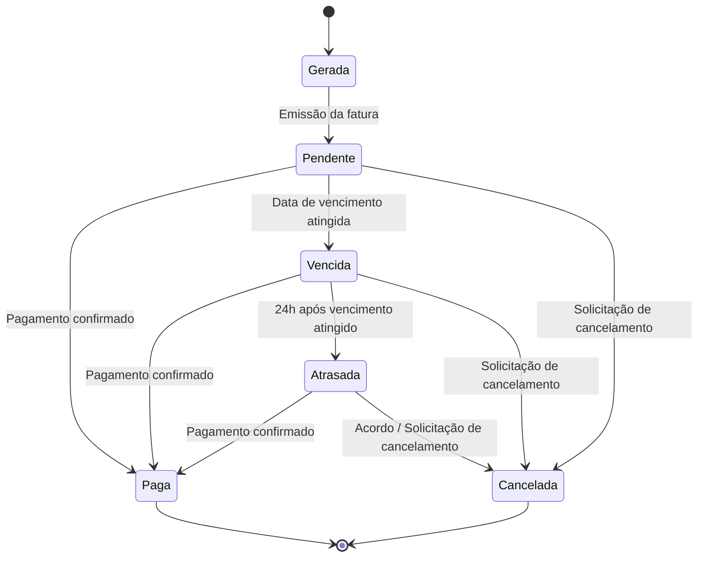
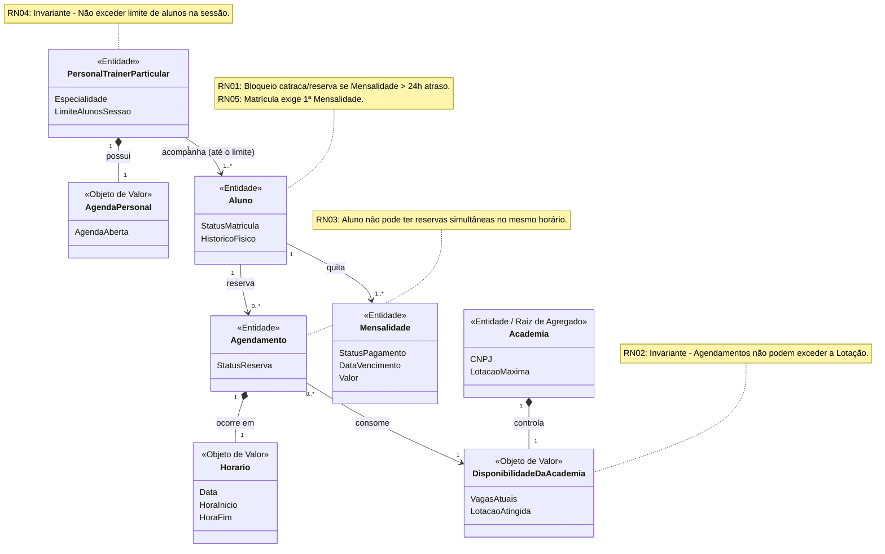

# Da Informação ao Domínio: Construindo o Modelo Conceitual do Sistema

## Sistema de Gestão de Academias e Personal Trainers

**Grupo:** *Eu Quero, Eu Posso*.
**Integrantes:** Mariana Veiga e Vitor Thomé.
**Tema escolhido:** Sistema de gestão de academias e personal trainers.
**Disciplina:** Desenvolvimento de Sistemas Corporativos.
**Data:** 20/09/2026.

---

## ETAPA 1 — Retomada do sistema

- **Nome do sistema**: Sistema de gestão de academias e personal trainers.
- **Problema central**: Alta evasão de alunos causada pela falta de acompanhamento invidivualizado e a perda de receita oriunda de controles financeiros falhos e descentralizados.
- **Contexto**: Academias de pequeno ou de médio porte que controlam hoje seus processos via planilha ou softwares mais antigos, e esse controle costuma se limitar a verificar se a mensalidade foi paga, sem acompanhar frequência, evolução física ou desempenho do aluno de forma íntegra.
- **Público ou atores principais**: Aluno, Personal-trainer, Recepcionista, Administrador, Gateway de pagamento (sistema externo) e Sistema de controle de acesso (sistema externo)
- **Objetivo da solução**: Não depender mais de erros humanos feitos no papel, implementando um sistema que fará tudo automaticamente e centralizado e desistência, bem como evitar a evasão de alunos por meio de acompanhamento individualizado.
- **Fluxo ou fluxos mais importantes já analisados**: "Fluxo de Agendamento de Sessão de Treino" e o "Fluxo de Controle de Acesso (Catraca)".
- **Principais operações identificadas**: "Processar o Pagamento de Mensalides", "Relizar Check-in/Controle de Acesso" e "Reservar horário com Personal".
- **Principais informações que o sistema precisa conhecer ou preservar**: Staus Financeiro/Mensalidades de cada Aluno, as Agendas dos Personais e a Capacidade de Lotação do ambiente físico.

---

## ETAPA 2 — Rastreabilidade do conhecimento anterior

| Elemento anterior | Descrição resumida | Como influencia a modelagem atual |
|-------------------|--------------------|-----------------------------------|
| Fato | Lotação Máxima e bloqueio automática na Catraca | Provou que a "Disponibilidade da Academia" não é um Objeto de Valor, mas sim um Estado dinâmico |
| Fato | Dois tipos de Personal Trainer: Particular e o da Academia | Alterou a semântica da relação entre Personal e Aluno na modelagem |
| Decisão | A catraca bloqueia automaticamente o acesso após 24 horas de inadimplência | brigou a classificar a Mensalidade como uma Entidade com ciclo de vida, em vez de um mero Objeto de Valor, pois requer rastreamento de ID para contagem das 24h |

---

## ETAPA 3 — Candidatos a conceitos do domínio

| **Candidato** | **De onde surgiu?** | **Por que parece necessário?** | **Grau de certeza C/H/?** |
| --------------|---------------------|--------------------------------|---------------------------|
| Disponibilidade do personal | Fluxo principal | É necessário para que o aluno possa agendar um treinamento | C |
| Disponibilidade da academia | Fluxo principal | É necessário para que o aluno consiga agendar um treinamento | C |
| Mensalidade | Fluxo principal | É necessário para que o aluno tenha a condição de agendar um treino | C |
| Confirmação | Fluxo principal | Para agendar o treino | ? |
| Aluno | Fluxo principal | Representa a pessoa que vai solicitar e executar o treino | C |
| Personal Trainer | Fluxo principal | Representa a pessoa responsavel para instruir o aluno | C |
| Academia | Fluxo principal | Local fisico na qual os alunos e personal trainers frequentam | C |
| Agendamento (Sessão de Treino) | Fluxo alternativo | Representa a reserva de um horário de treino entre o aluno, personal e academia | C |

---

## ETAPA 4 — Investigação de identidade

| Conceito | Identidade parece relevante? | Evidência / justificativa | Classificação atual |
|----------|------------------------------|---------------------------|---------------------|
| Mensalidade | Sim | Ocorrências com os mesmos atributos podem ser distintas; possui ciclo de vida (Gerada → Pendente → Paga) e exige rastreabilidade no histórico financeiro | Entidade |
| Agendamento | Sim | Ocorrências com os mesmos atributos podem ser distintas; possui ciclo de vida (Solicitado → Em análise Confirmado → Executado/Cancelado) e exige rastreabilidade no agendamento para controle de presença do aluno | Entidade |
| Aluno | Sim | Ocorrências com os mesmos atributos podem ser distintas; possui ciclo de vida (Matriculado → Ativo → Inadimplente/Suspenso → Cancelado) e exige o reconhecimento da mesma ocorrência posteriormente | Entidade |

---

## ETAPA 5 — Entidades, Objetos de Valor e outros conceitos

| Conceito | Classificação atual | Justificativa | Evidência | Grau de certeza C/H/?|
|----------|---------------------|---------------|-----------|-----------------|
| Aluno | Entidade | A identidade importa e precisa ser rastreada ao longo do tempo | Possui ciclo de vida contínuo e é o ator central de retenção | C |
| Agendamento | Entidade | Tem ciclo de vida e precisa rastrear essa reserva específica posteriormente | A dupla Aluno/Personal no mesmo horário pode gerar agendamentos diferentes se houver reagendamentos; O Agendamento transita entre estados e sofre concorrência | C |
| Mensalidade | Entidade | Passa por transições de estado e precisa ser rastreada individualmente para dar baixa no sistema | A regra crítica de "bloqueio da catraca" depende do ID da mensalidade para saber exatamente qual competência está pendente | C |
| Personal Trainer | Entidade | Tem identidade única e agenda própria. Dois personais com o mesmo nome são pessoas diferentes | O sistema deve distinguir o "Personal da academia" do "Particular". Dois personais com o mesmo nome e especialidade são cadastros distintos | C |
| Disponibilidade da Academia | Estado | Descreve uma característica. Se trocar por outra igual, o resultado para o negócio é o mesmo | A lotação varia a cada giro da catraca | C |
| Disponibilidade do Personal | Informação insuficiente | Não temos certeza se é um Objeto de Valor ou uma Entidade | - | H |
| Confirmação | Evento de Domínio | Representa a mudança de status final de um Agendamento | Confirmação e geração do evento de domínio AgendamentoConfirmado | C |
| Academia | Entidade | Representa uma unidade física com CNPJ, endereço e limite de capacidade distintos de outras unidades da mesma rede | Uma filial tem limites de catraca próprios e não se confunde com as outras, mesmo pertencendo à mesma rede | C |

---

## ETAPA 6 — Casos de classificação ambígua

**Conceito 1: Disponibilidade da Academia**
- **Classificação inicialmente considerada**: Objeto de Valor. 
- **Dúvida encontrada**: Objeto de Valor seria um valor imutável, o que não condiz com a lotação do espaço.
- **Alternativas analisadas:** Entidade e Estado.
- **Evidências disponíveis**: O sisterma externo (Sistema de controle de acesso) altera a disponibilidade a cada momento que uma pessoa entra ou sai.
- **Classificação atual**: Estado.
- **Grau de certeza**: Certeza (C).
- **Informação que poderia fazer essa classificação mudar**: Se o negócio evoluir para exigir reserva antecipada em horários de pico (garantindo vagas para treinar). Nesse cenário, a "Disponibilidade" deixaria de ser um Estado simples e passaria a ser controlada por uma Entidade, que possuiria ID, ciclo de vida e controle de concorrência por vagas.

**Conceito 2: Mensalidade**
- **Classificação inicialmente considerada**: Objeto de Valor.
- **Dúvida encontrada**: Objeto de Valor seria um valor fixo, que poderia ser substituído sem grandes impactos se houvesse alguma alteração ou erro de cobrança, não exigindo uma identidade própria.
- **Alternativas analisadas:** Entidade e Objeto de Valor.
- **Evidências disponíveis**: A regra D01 do negócio determina que "o bloqueio automático na catraca por inadimplência ocorrerá após 24 horas do vencimento da fatura". Além disso, se a integração com a catraca falhar, há impacto operacional imediato. Para o sistema garantir exatamente o lapso de 24 horas e aplicar o bloqueio no aluno correto, ele precisa monitorar a transição de estado de uma fatura específica (Gerada → Vencida → Atrasada). Isso só é possível se essa fatura tiver uma identidade acompanhada no tempo.
- **Classificação atual**: Entidade.
- **Grau de certeza**: Certeza.
- **Informação que poderia fazer essa classificação mudar**: Se a academia adotasse uma "Catraca Inteligente" de mercado que assumisse a gestão dos pagamentos de forma independente. Nesse cenário, o nosso sistema deixaria de gerenciar o ciclo de vida e a cobrança de cada mês (deixando de ser uma Entidade), e passaria a enxergar a situação do aluno apenas como um estado externo importado via API.

---

## ETAPA 7 — Relações entre conceitos

| Conceito A | Relação | Conceito B | Significado no domínio | Evidência |
|------------|---------|------------|------------------------|-----------|
| Aluno | Reserva | Agendamento (Sessão de Treino) | Representa a intenção confirmada de uso de um serviço e de um recurso físico | O fluxo principal atualizado exige que, para gerar o AgendamentoConfirmado, o sistema valide antes a inadimplência (<24h) e a Lotação Máxima do espaço físico |
| Personal Trainer (Particular) | Acompanha | Aluno | Estabelece um vínculo de exclusividade (1:1). O aluno que contrata um Personal Particular não é atendido pelos personais contratados da academia durante esse agendamento | A existência de dois tipos de Personal. Essa distinção afeta diretamente o módulo de Gestão de Usuários e a regra de Agendamento |
| Agendamento | Consome | Disponibilidade da Academia | Cada agendamento efetivado reduz em 1 a capacidade máxima de pessoas que a filial suporta naquele exato momento | A lotação máxima é uma "Invariante" física. O fluxo principal foi alterado no Trabalho anterior (revisão da arquitetura) para incluir: "O sistema valida a Lotação Máxima do espaço físico" |
| Aluno | Quita | Mensalidade | A quitação da mensalidade é a condição essencial para a manutenção do Status Ativo do aluno | A regra "D01" exige bloqueio automático na catraca se o aluno acumular mais de 24 horas de inadimplência após o vencimento da fatura |

---

## ETAPA 8 — Cardinalidades

| Relação | Cardinalidade atual | Evidência | Grau de certeza |
|---------|---------------------|-----------|-----------------|
| Personal Trainer (Particular) [Acompanha] Aluno | 1:1...N (com limite) | Lado 1: O aluno só pode estar vinculado a exatamente um personal particular durante uma sessão de agendamento (não pode ter 2 personais simultâneos). Lado 1..N: O personal pode atender o aluno com exclusividade (1:1) ou atender pequenos grupos simultaneamente (1:N), sendo necessário que o domínio controle um limite máximo de alunos por sessão | Confirmada (com limite a definir) |
| Aluno [Reserva] Agendamento | 1:0...N | Lado 1: A entidade de agendamento funciona como uma reserva nominal (ticket). Para garantir a integridade do cálculo de lotação e aplicar a regra que impede um aluno de reservar duas vezes o mesmo horário, cada agendamento pertence a exatamente um aluno. Lado 0..N: O fluxo principal permite o acesso livre da catraca em horários de baixa ocupação, logo, um aluno ativo pode existir com zero agendamentos históricos | Confirmada |
| Agendamento [Consome] Disponibilidade da Academia | N:1 (com limite de lotação) | Lado 1: Cada agendamento (ticket) é individual e reduz exatamente 1 vaga da disponibilidade global do horário. Lado N: O estado de Disponibilidade da academia é compartilhado e recebe múltiplos agendamentos simultâneos. A regra de negócio trava a criação de novos agendamentos no momento em que o total (N) atinge a Lotação Máxima permitida (Invariante) | Confirmada |
| Aluno [Quita] Mensalidade | 1:N | O controle de acesso (catraca) e a tolerância de 24h são individuais (por CPF/Matrícula), impossibilitando faturas familiares (lado 1). O processo de matrícula exige a geração imediata da primeira cobrança, impossibilitando um aluno ativo sem mensalidade (lado 1..N).| Confirmada |

## ETAPA 9 — Regras de Negócio

| ID | Regra de Negócio | Conceitos envolvidos | Origem / evidência | Situação |
|----|------------------|----------------------|--------------------|----------|
| RN01 | O acesso físico do aluno (e a confirmação de novos agendamentos) deve ser bloqueado somente se houver uma mensalidade com mais de 24 horas de atraso em relação ao vencimento | Aluno, Mensalidade | D01: O bloqueio automático na catraca por inadimplência ocorrerá após 24 horas do vencimento da fatura | Confirmada |
| RN02 | Um novo agendamento somente pode ser confirmado se houver vagas disponíveis, respeitando o limite da capacidade máxima da academia no momento da sessão | Agendamento, Disponibilidade da academia | H04: Uma sessão de treino não pode ser agendada quando a academia estiver em capacidade máxima | Confirmada |
| RN03 | O sistema deve impedir que o Aluno reserve mais de uma sessão de treino no mesmo horário exato, garantindo a integridade do ticket nominal | Aluno, Agendamento | Investigação da Etapa 8: Restrição de concorrência nominal (O mesmo CPF não pode ocupar dois lugares físicos simultâneos) | Confirmada |
| RN04 | O número de alunos acompanhados simultaneamente por um Personal Trainer Particular não pode exceder o limite de X alunos configurado para a sessão, garantindo a exclusividade ou a qualidade do pequeno grupo | Personal Trainer, Aluno | Investigação da Etapa 8: Limite de capacidade da sessão de atendimento personalizado | Confirmada (limite a ser definido) |
| RN05 | A efetivação de um novo cadastro de Aluno, mudando seu estado para "Ativo", requer a geração imediata da primeira Mensalidade | Aluno, Mensalidade | nvestigação da Etapa 6 e 8: Processo de matrícula e cardinalidade (o aluno não pode existir no sistema sem uma mensalidade vinculada) | Confirmada |

---

## ETAPA 10 — Invariantes e proteção da consistência

| Conceito protegido | Possível invariante | O que poderia violá-la? | Consequência | Evidência |
|--------------------|---------------------|-------------------------|--------------|-----------|
| Disponibilidade da Academia | O número total de Agendamentos ativos para um mesmo horário não pode, sob nenhuma hipótese, ultrapassar a Lotação Máxima da academia. | Uma falha de concorrência (dois alunos agendando a última vaga no exato mesmo milissegundo) ou falha ao abater uma vaga na catraca física. | Superlotação do espaço, quebrando o limite físico, gerando risco e frustração para os alunos que reservaram. | RN02 e Etapa 8 (Lotação Máxima como Invariante). |
| Aluno (Status / Acesso) | Um Aluno não pode ter acesso físico liberado ou criar novos Agendamentos se possuir uma Mensalidade com status de atraso superior a 24 horas. | A falha em um job de atualização noturna do status financeiro ou indisponibilidade na integração com o Gateway de Pagamento. | Alunos inadimplentes usando o serviço, agravando o problema central de perda de receita citado na Etapa 1. | RN01 e D01 (Regra de bloqueio da catraca). |
| Agendamento (Integridade do Ticket) | Um mesmo Aluno não pode possuir dois ou mais Agendamentos concorrentes (no mesmo exato horário). | O aluno dar um "duplo clique" no botão de agendar e a aplicação não travar a requisição duplicada no backend. | Ocupação de múltiplas vagas "fantasma" na disponibilidade da academia, impedindo outros alunos de treinarem. | RN03 (Restrição de concorrência nominal). |
| Sessão de Treino (Personal) | A quantidade de Alunos agendados simultaneamente com um mesmo Personal Trainer (Particular) não pode exceder o limite (X) configurado para aquele profissional | Uma falha no momento de checar a cardinalidade atual do Personal antes de salvar o agendamento de um grupo. | Perda do acompanhamento individualizado, que vai contra o objetivo central do projeto de reduzir a evasão.    | RN04 e Etapa 8 (Limite de capacidade da sessão). |
| Aluno (Integridade da Matrícula) | O Aluno no estado "Ativo" deve ter, obrigatoriamente, ao menos 1 (uma) Mensalidade vinculada à sua identidade. | Erro no fluxo de criação de usuário, salvando o cadastro do aluno no banco de dados mas falhando ao gerar a fatura. | Um aluno "fantasma" que passaria livre pela catraca infinitamente, pois não haveria mensalidade para vencer. | RN05 e Etapa 8 (O aluno não pode existir sem mensalidade). |

---

## ETAPA 11 — Estados e ciclo de vida

Para esta etapa, a entidade escolhida é a Mensalidade, por ser uma Entidade importante que possui mudanças significativas ao longo do tempo e que impacta diretamente a regra de bloqueio da catraca (evasão e receita).

Identificação dos elementos do ciclo de vida:

- Estado inicial: Gerada.
- Estados intermediários: Pendente, Vencida, Atrasada.   Estado ou estados finais: Paga, Cancelada.
- Eventos que provocam mudanças: Emissão da fatura, confirmação de pagamento pelo Gateway, atingimento da data de vencimento, decurso de 24 horas após o vencimento, e solicitação de cancelamento.

**Transições válidas:**
- Gerada $\rightarrow$ Pendente
- Pendente $\rightarrow$ Paga
- Pendente $\rightarrow$ Vencida
- Vencida $\rightarrow$ Paga
- Vencida $\rightarrow$ Atrasada
- Atrasada $\rightarrow$ Paga
- Pendente / Vencida / Atrasada $\rightarrow$ Cancelada.

**Transições inválidas:**
- Paga $\rightarrow$ Atrasada (uma fatura quitada não pode voltar a ficar em atraso).
- Atrasada $\rightarrow$ Pendente (o tempo não retrocede para antes do vencimento).
- Cancelada $\rightarrow$ Paga (uma fatura morta não pode receber pagamento direto sem ser reemitida). 

**Regras relacionadas:** RN01 e D01 (O acesso físico deve ser bloqueado na catraca se houver mensalidade com mais de 24 horas de atraso, que corresponde ao estado "Atrasada").

---

## ETAPA 12 — Primeiro Modelo Conceitual do sistema

---

## ETAPA 13 — Explicação do Modelo Conceitual

**Por que cada conceito principal está presente**
- Aluno: É o ator central do domínio, necessário para monitorar a frequência, gerenciar as reservas e mitigar a evasão.

- Mensalidade: Fundamental para sanar o problema de perda de receita, viabilizando o bloqueio de inadimplentes.

- Agendamento: Garante a reserva nominal de uma vaga, organizando o fluxo de pessoas.

- PersonalTrainerParticular: Essencial para o acompanhamento individualizado, justificando regras de exclusividade e limites de atendimento.

- Academia: Representa a unidade física que impõe o limite estrutural (Lotação Máxima) para os treinos.

- DisponibilidadeDaAcademia: Controla o estado momentâneo de vagas, impedindo a superlotação física.

**Elementos que possuem identidade**

Aluno, Mensalidade, Agendamento, PersonalTrainerParticular e Academia. Eles sofrem transições de estado, como a mensalidade que passa de "Pendente" para "Atrasada", exigindo um identificador único para aplicar regras precisas.

**Elementos tratados como Objetos de Valor**

Horario foi modelado como Objeto de Valor. Ele agrupa os atributos imutáveis Data, HoraInicio e HoraFim. Se o horário de uma sessão mudar, o sistema não altera o objeto atual, mas sim o substitui por um novo Objeto de Valor, pois sua identidade não importa, apenas a sua composição de tempo. Além disso, a DisponibilidadeDaAcademia (VagasAtuais) e a AgendaPersonal foram modeladas como Objetos de Valor compostos dentro de suas respectivas Entidades Raiz (Academia e Personal), pois representam apenas o estado quantitativo/descritivo naquele momento, sem ciclo de vida independente.

**Relações mais importantes**

- Aluno [quita] Mensalidade: Relação vital para garantir a saúde financeira e acionar automaticamente a regra de bloqueio do acesso físico (catraca).

- Agendamento [consome] DisponibilidadeDaAcademia: Relação crítica de concorrência que impede o sistema de confirmar treinos além da Lotação Máxima, protegendo a invariante física da academia.

**Cardinalidades confirmadas**

- 1 Aluno para 1.. Mensalidades:* Confirmada, pois o ato da matrícula (criação do aluno) exige a emissão imediata da primeira mensalidade, impossibilitando um aluno existir com zero faturas.

- 1 Aluno para 0.. Agendamentos:* Confirmada, pois o agendamento é estritamente nominal (pertence a um único CPF), mas um aluno novo ou que frequente em horários livres pode ter zero reservas.

- 0.. Agendamentos para 1 DisponibilidadeDaAcademia:* Confirmada, pois vários agendamentos concorrentes reduzem as vagas do mesmo estado global de lotação.

**Cardinalidades que permanecem como hipótese**

A cardinalidade 1 PersonalTrainerParticular para 1.. Aluno* (no relacionamento de acompanhamento) permanece parcialmente como hipótese. Embora saibamos que o personal atende pelo menos um aluno (1), o limite superior ainda requer definição com as partes interessadas.

**Regras que influenciam diretamente o modelo**

- RN01 (Bloqueio 24h): Influencia diretamente a relação entre Aluno e Mensalidade, determinando o status de matrícula.

- RN02 (Limite de Lotação): Obriga a existência do estado DisponibilidadeDaAcademia para validar se um Agendamento pode ser efetivado.

- RN03 (Concorrência Nominal): Trava a criação de múltiplos Agendamentos para o mesmo Aluno no mesmo Horario.

- RN05 (Matrícula exige Mensalidade): Força a cardinalidade mínima de 1 do lado da Mensalidade.

**Elementos que ainda apresentam incerteza**

A AgendaPersonal foi modelada inicialmente como um Objeto de Valor, assumindo que ela reflete apenas um estado descritivo da agenda do profissional. No entanto, a equipe precisará validar com os stakeholders se, no futuro, essa agenda exigirá controle de concorrência próprio, ID rastreável e gerenciamento de bloqueios/folgas. Caso positivo, ela precisará ser promovida a Entidade nas próximas iterações do design.

## ETAPA 14 — Evolução do modelo

| Momento | Alteração realizada | Motivo | Evidência ou descoberta que provocou a mudança |
|---------|---------------------|--------|------------------------------------------------|
| Identificação inicial | Levantamento dos candidatos a conceitos como Aluno, Mensalidade, Agendamento, Disponibilidade e Academia. | Necessidade de extrair os substantivos e elementos centrais para resolver o problema de evasão e inadimplência. | Análise dos fluxos principais ("Agendamento de Sessão" e "Controle de Acesso") definidos na Etapa 1. |
| Investigação de identidade | Reclassificação de Mensalidade (para Entidade) e de Disponibilidade da Academia (para Estado). | A Mensalidade requer rastreamento do seu ciclo de vida, enquanto a Disponibilidade sofre mutação constante sem importar sua identidade. | Descoberta de que a regra da catraca exige contar 24h a partir do vencimento de uma fatura específica (Etapa 6). |
| Relações | Criação das conexões comportamentais, como Personal Particular "acompanha" Aluno e Agendamento "consome" DisponibilidadeDaAcademia. | Conectar conceitos isolados para refletir como o domínio da academia realmente funciona na prática. | A descoberta de que existem dois tipos de Personal (Particular vs. Academia), alterando a semântica da exclusividade no atendimento (Etapa 7). |
| Cardinalidades | Definição de limites estritos, como a exigência de que um Aluno esteja ligado a 1..* (uma ou mais) Mensalidades. | Impedir a existência de alunos "fantasmas" que tenham acesso liberado sem nunca gerar cobrança. | A constatação de que o processo de matrícula obriga a geração imediata da primeira cobrança (Etapa 8). |
| Regras | Elevação das regras RN02 e RN04 ao status de Invariantes, acoplando notas de restrição diretamente ao modelo. | Proteger o sistema contra race conditions (superlotação) e garantir que a capacidade máxima nunca seja violada. | O mapeamento de que uma falha de concorrência geraria a confirmação de agendamentos além do limite físico do espaço (Etapa 10). |
| Modelo atual | Separação do conceito de Horario como um Objeto de Valor e manutenção da DisponibilidadeDoPersonal como uma incerteza. | Refinar a precisão do domínio (horários são valores imutáveis) e evitar assumir falsas certezas sobre o funcionamento da agenda. | A revisão final evidenciou que a equipe ainda não tem informações suficientes para definir o ciclo de vida da agenda do personal (Etapa 12). |

---

## ETAPA 15 — Revisões identificadas em relação aos documentos anteriores

| Documento ou conhecimento anterior | Revisão identificada | Motivo | Impacto futuro |
|------------------------------------|----------------------|--------|----------------|
| Visão Geral do Domínio / Mapeamento de Candidatos (Etapas 1 e 5) | Promoção do atributo `Horario` a Objeto de Valor (`<<Objeto de Valor>>`). | Percebeu-se que o horário de treino (Data, HoraInicio, HoraFim) possui valor imutável e precisa ser comparado de forma isolada para evitar choques de agenda (RN03). | Atualização do Dicionário de Linguagem Ubíqua e especificação de implementação no código como um Value Object do DDD. |
| Mapeamento de Entidades e Regras de Negócio (Etapas 6 e 10) | Vínculo explícito e condicional entre `Mensalidade` (RN01) e o direito ao `Agendamento`. | O entendimento de bloqueio após 24h exigia um mecanismo transparente de verificação do status da mensalidade no momento exato de cada nova reserva. | Necessidade de integração em tempo real com a API do gateway de pagamentos no momento do agendamento e da validação do acesso. |
| Identificação de Conceitos de Apoio (Etapa 7) | Formalização da `DisponibilidadeDoPersonal` com o estereótipo de incerteza (`<<Incerteza: Objeto ou Entidade?>>`). | Falta de evidências de negócio para definir se o Personal gerencia folgas e horários dentro do sistema ou via ferramenta externa. | Agendamento de uma nova sessão de descoberta (*Discovery*) com os stakeholders antes de iniciar o desenvolvimento do módulo de personais. |
| Definição de Capacidade da Academia (Etapas 2 e 10) | Isolamento do estado de vagas na entidade `DisponibilidadeDaAcademia` (RN02). | A Lotação Máxima da Academia não é um dado estático do cadastro da unidade, mas um estado de ocupação altamente dinâmico afetado por concorrência simultânea. | A arquitetura de software deverá implementar mecanismos de controle de concorrência (como *Locks* transacionais) para evitar a sobrealocação de vagas. |

---

## ETAPA 16 — Registro de pendências de governança

| Item a revisar futuramente | Motivo | Prioridade | Consequência se permanecer desatualizado |
|----------------------------|--------|------------|------------------------------------------|
| Dicionário de Linguagem Ubíqua | Adicionar formalmente a definição do conceito `Horario` como Objeto de Valor e explicitar seus atributos imutáveis. | Média | Divergência de termos entre a equipe de desenvolvimento e o especialista de domínio, gerando ruído na implementação. |
| Especificação do Módulo de Personais (`DisponibilidadeDoPersonal`) | Definir se a agenda do personal é uma Entidade com ciclo de vida próprio ou apenas um Objeto de Valor, após rodada de *Discovery*. | Alta | Riscos de modelagem incorreta no software, gerando retrabalho na arquitetura de persistência e regras de agendamento. |
| Mapeamento de Casos de Uso e Fluxos de Agendamento | Atualizar os passos do fluxo para incluir a verificação síncrona e obrigatória do status da `Mensalidade` (RN01) antes de criar a reserva. | Alta | Inconsistência entre os requisitos e a implementação, podendo levar a falhas de segurança onde alunos inadimplentes conseguem agendar treinos. |
| Documento de Requisitos Não-Funcionais (Concorrência) | Especificar a estratégia técnica de *Lock* (otimista/pessimista) para o controle dinâmico de vagas na `DisponibilidadeDaAcademia` (RN02). | Média | Risco de ocorrência de *race conditions* em horários de pico, permitindo agendamentos acima da capacidade física máxima. |

---

## ETAPA 17 — Análise crítica do modelo

Responda:

1. Qual parte do modelo possui melhor sustentação?
A classificação da Mensalidade como uma Entidade.

2. Qual conceito possui classificação mais incerta?
A DisponibilidadeDoPersonal como uma incerteza.

3. Qual relação possui justificativa mais frágil?
A relação Agendamento "1" --> "1" Confirmacao : gera.

4. Qual cardinalidade ainda precisa de validação?
A relação PersonalTrainerParticular "1" --> "1..* (N)" Aluno

5. Qual regra possui maior impacto sobre o modelo?
A RN02 (Limite de Lotação). Ela impõe que a academia não ultrapasse sua capacidade máxima física.

6. Existe alguma decisão baseada principalmente em intuição?
Sim. Na Etapa 10 (Invariantes), a proteção do domínio baseando-se em intuições tecnológicas, como "job de atualização noturna", "banco de dados" e "duplo clique".

7. Qual hipótese, se rejeitada, provocaria maior mudança?
A hipótese implícita de que o nosso sistema é a fonte da verdade do controle financeiro. Citada na Etapa 6 que se houver uma "Catraca Inteligente" associada a um gateway, a gestão do pagamento muda de mãos.

8. Que nova informação poderia modificar significativamente o modelo?
A evolução citada na Etapa 6: "Exigir reserva antecipada da academia inteira em horários de pico".

9. Qual parte provavelmente será revisada futuramente?
O módulo de Agendas (DisponibilidadeDoPersonal), listado na sua Etapa 16.  A sessão de Discovery, gerenciar o tempo de um ser funcionário (férias, atestados, almoço, deslocamento) é extremamente complexo.

10. Existe alguma contradição entre este trabalho e documentação anterior?
Sim, existem contradições estruturais como o desaparecimento do "Personal da Academia".

---

## ETAPA 18 — Reflexão da equipe

Encerre o trabalho respondendo:

- O que foi descoberto sobre o sistema que não estava claro anteriormente?
Para o software saber exatamente o momento desse bloqueio, a Mensalidade precisava deixar de ser um dado anêmico e ganhar uma máquina de estados rigorosa.
Antes, falava sobre impedir choque de agendamentos de forma genérica. Agora, descobriu que o Horario precisa ser extraído como um Objeto de Valor imutável.
No trabalho atual (Etapa 13 e 15), foi criada a DisponibilidadeDoPersonal e a classificá-la como uma grande incerteza.

- Qual conceito foi mais difícil de classificar?
A Disponibilidade da Academia (Etapa 6) e a Disponibilidade do Personal (Etapas 12 e 13).

- Qual relação exigiu maior discussão?
A relação Agendamento [consome] DisponibilidadeDaAcademia (Etapas 7 e 8) e a relação PersonalTrainerParticular [acompanha] Aluno.

- Alguma informação inicialmente simples passou a ser reconhecida como Entidade?
A Mensalidade (Etapa 6). Era considerada um mero Objeto de Valor numérico (um valor a ser pago).

- Algum conceito inicialmente considerado Entidade deixou de parecer necessário?
O Personal da Academia (o instrutor de salão). Embora tenha sido mapeado a existência dele na Revisão Arquitetural anterior como uma grande descoberta (para diferenciá-lo do Personal Particular), ele sumiu completamente do seu modelo da Etapa 12.

- Alguma cardinalidade aparentemente óbvia revelou-se uma hipótese?
A cardinalidade PersonalTrainerParticular "1" --> "1..* (N)" Aluno (Etapa 13). Assumida que existe um limite máximo configurável ("X") para o atendimento simultâneo (RN04), mas não sabe qual é.

- Qual Regra de Negócio mais influenciou o modelo?
As RN01 (Bloqueio 24h) e RN02 (Limite de Lotação).

- Qual decisão anterior precisaria ser revisada?
As documentadas na sua Etapa 16: o Dicionário de Linguagem Ubíqua (para formalizar o Objeto de Valor Horario), a Especificação do Módulo de Personais (que exigirá um Discovery inteiro) e o Documento de Requisitos Não-Funcionais, para definir a estratégia de Lock (otimista/pessimista).

- O que esta atividade mudou na compreensão do sistema?
A modelagem revelou que o escopo era muito maior do que pensávamos.

- A equipe considera o modelo atual suficientemente fundamentado para sustentar as próximas etapas do projeto? Por quê?
Sim/Não, pois conseguimos mapear todas as regras de negócio listadas no levantamento de requisitos sem deixar ambiguidades. Entretanto, não é possivel ter uma confirmação concreta se esta tudo 100%.

---

## Apêndice — Uso de Inteligência Artificial

Caso a equipe utilize IA, inclua ao final:

### Ferramenta utilizada

Gemini 3.1 Pro

### Finalidade

Pesquisa com mais velocidade, aperfeiçoar a qualidade dos esquemas (alguns montados manualmente ficavam muito embaralhados), e uma revisão geral de possiveis erros.

### Contribuições relevantes

A IA apontou que a classificação de DisponibilidadeDaAcademia como Estado viola a gramática tática do Domain-Driven Design

### Hipóteses reveladas

Autonomia da Gestão Financeira (Source of Truth): Percebeu-se a suposição implícita de que o sistema modelado será sempre a autoridade absoluta do ciclo de vida das cobranças.

### Classificações questionadas

DisponibilidadeDaAcademia: Reconsiderada a sua classificação de Estado (conceito inexistente no DDD tático) para ser incorporada como estado interno gerido dentro do Agregado Academia ou como uma Entidade de controle de concorrência.

### Sugestões rejeitadas

Rebaixamento da Mensalidade para Objeto de Valor:

### Avaliação crítica

Responda:

- Onde a IA ajudou?
Na pesquisa de forma mais rápida, revisão geral, modelagem de diagramas e retirada de duvidas.

- Onde apresentou limitações?
O prompt configurou a IA para atuar de forma socrática. Ela não fornecia respostas diretas, forçando a equipe a deduzir as conclusões, o que elevou o esforço cognitivo, mas garantiu a autoria do modelo.

- Tentou inventar informações?
algumas vezes, entretanto as informações vinham com uma explicação convincente.

- Apresentou respostas convincentes sem evidência?
Sim, entretanto foi pedido uma justificativa/fonte.

- Como as sugestões foram verificadas?
Confrontando as sugestões da IA diretamente com as regras de negócio levantadas nos Trabalhos 1 e 2. Se a sugestão não tivesse lastro na nossa documentação de requisitos, era desconsiderada.

### Questão final obrigatória

> *Se a IA fosse retirada agora, a equipe conseguiria explicar, justificar e defender cada elemento do modelo conceitual produzido?*

Sim. Embora a construção do modelo em seus estágios iniciais tenha sido complexa e o uso da IA como revisora socrática tenha acelerado a descoberta de falhas (como invariantes e concorrência), a equipe apropriou-se do domínio. Como a IA foi proibida de gerar respostas diretas, cada regra de negócio, cardinalidade e entidade presente neste documento foi ativamente decidida, justificada e registrada por nós, garantindo total capacidade de defesa do modelo atual perante qualquer questionamento.
