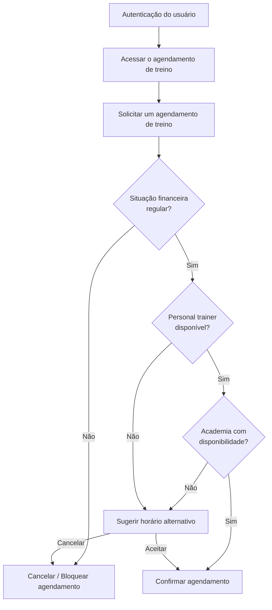

# Objetivo do Trabalho
## Sistema de Gestão de Academias e Personal Trainers

**Grupo:** *Eu Quero, Eu Posso*.
**Integrantes:** Mariana Veiga e Vitor Thomé.
**Tema escolhido:** Sistema de gestão de academias e personal trainers.
**Disciplina:** Desenvolvimento de Sistemas Corporativos.
**Data:** 09/09/2026.

## ETAPA 1 — Apresentação do sistema

- **Nome do sistema:** FitVital.
- **Problema que pretende resolver:** Não depender mais de erros humanos feitos no papel, implementando um sistema que fará tudo automaticamente e centralizado e desistência.
- **Contexto no qual o problema ocorre:** Academias de pequeno/médio porte controlam hoje seus processos via planilha ou softwares mais antigos, e esse controle costuma se limitar a verificar se a mensalidade foi paga, sem acompanhar frequência, evolução física ou desempenho do aluno de forma integra.
- **Quem é afetado pelo problema:** todos os atores do sistema, tais como o aluno, personal trainer, administrador e recepcionista, exceto os atores do sistema externo (gateway de pagamento e o sistema de controle de acessso).
- **Público-alvo ou usuários principais:** Academias de pequeno ou médio porte que não possuem grande volume de clientes.
- **Objetivo principal da solução:** Centralizar a gestão de alunos e otimizar o acompanhamento físico e financeiro, evitando evasão.

---

## ETAPA 2 — Quadro de conhecimento atual

- **FATO** — Informação confirmada e sustentada por alguma evidência.
- **HIPÓTESE** — Suposição plausível que ainda precisa ser validada.
- **QUESTÃO EM ABERTO** — Algo que ainda precisa ser investigado antes de uma conclusão.
- **DECISÃO** — Escolha já realizada pela equipe e que precisa possuir justificativa.

| ID  | Tipo     | Descrição | Evidência / Como validar / Justificativa | Estado |
| --- | -------- |:----------------------------------------------------------------------------------------------------------------------------------------------------------- | ---------------------------------------- | ---------- |
| F01 | Fato | Cada aluno pode ser acompanhado por um personal trainer | Relato comum dos donos de academia e observação da dinâmica atual de treinos | Confirmado |
| F02 | Fato | Todo aluno deve ter o pagamento em dia caso queira usar os serviços | Política financeira padrão exigida pelos administradores das academias | Confirmado |
| F03 | Fato | Todo personal deve acompanhar ao menos um aluno | Regra de negócio (um personal só precisa de acesso ao sistema se tiver clientes na unidade) | Confirmado |
| F04 | Fato | A recepcionista deve fornecer ao menos uma forma de acesso a academia aos alunos | Observação direta do processo de liberação na recepção | Confirmado |
| F05 | Fato | O administrador é responsavel por administrar os funcionários | Estrutura organizacional padrão de pequenos negócios | Confirmado |
| H01 | Hipótese | O aluno não pode ter mais de 1 plano de treino personalizado | Entrevistar professores para verificar se há casos de alunos com múltiplos planos simultâneos | Aberta |
| H02 | Hipótese | O sistema de entrada e saída não deve permitir que um aluno use a academia mais de uma vez no dia (ex: treinar pela manhã e retornar à noite) | Consultar o administrador sobre as regras comerciais dos planos da academia | Aberta |
| H03 | Hipótese | O personal trainer autônomo deve pagar uma taxa por aula à administração da academia para poder utilizar o espaço para atender seus alunos | Verificar os modelos de contratos e acordos verbais feitos com personais autônomos | Aberta |
| H04 | Hipótese | Uma sessão de treino não pode ser agendada quando a academia estiver em capacidade máxima | Confirmar com a gerência se existe uma contagem rígida de pessoas ou se a superlotação é apenas tolerada | Aberta |
| H05 | Hipótese | O valor do plano da academia pode ser alterado conforme a categoria, se a cobrança for anualmente, mensalmente, a cada n meses ou se houver alguma promoção | Levantar o histórico de campanhas promocionais diretamente na recepção | Aberta |
| Q01 | Questão | Alunos menores de 18 anos precisam de um termo assinado pelos pais anexado ao sistema? | Administração | Aberta |
| Q02 | Questão | Qual é o tempo de carência/tolerância para o aluno inadimplente ser bloqueado na catraca? | Recepcionista | Aberta |
| Q03 | Questão | A liberação manual da catraca pela recepção exige registro de justificativa no sistema? | Recepcionista | Aberta |
| D01 | Decisão | O bloqueio automático na catraca por inadimplência ocorrerá após 24 horas do vencimento da fatura | Margem operacional para compensação bancária de boletos sem gerar bloqueios indevidos | Fechada |

---

## ETAPA 3 — Escolha do fluxo principal

Fluxo principal escolhido: **Solicitar um agendamento de treino**
- **Objetivo:** Marcar uma sessão de treino com o personal trainer no horário solicitado pelo aluno.
- **Quem inicia:** Aluno.
- **Ponto de início:** Solicitar o treinamento com o personal.
- **Resultado esperado:** Agendamento do treino efetuado ou não efetuado, por conta de indisponibilidade do horário da academia, ou do personal trainer, bem como da capacidade da academia estar cheia.

---

## ETAPA 4 — Reconstrução do fluxo principal.

**Representação do fluxo como uma sequência de etapas:**

### Fluxo Principal com pontos de decisões — Agendamento de Treino

---

## ETAPA 5 — Análise das etapas do fluxo

| Etapa | Quem age? | Entrada | Saída | Decisão | O que pode impedir? |
|-------|-----------|---------|-------|---------|---------------------|
| Autenticação do usuário| Sistema | Dados de cadastro do usuário | Tela inicial | Não há| Falha na autenticação |
| Acessar o agendamento do treino | Aluno | Dados de cadastro do usuário | Tela de agendamento do treino | Sair ou Prosseguir da tela de agendamento | Falha no sistema |
| Solicitar um agendamento de treino | Aluno | Dados da disponibilidade da academia e do personal trainer | Exibir um formulário de agendamento de treino | Confirmar envio ou cancelar solicitação | Dados preenchidos incorretamente ou aluno inadimplente |
| Validar situação financeira | Sistema | ID do aluno, dados de mensalidade/plano | Status de adimplência | Aluno possui pendências financeiras? (Sim/Não) | Falha no banco de dados ao consultar o histórico de pagamentos |
| Verificar disponibilidade do personal trainer | Sistema | ID do personal, data e horário | Status da agenda do persona | Personal trainer disponível? (Sim/Não) | Conflito de agenda do personal ou horário fora do expediente |
| Personal trainer disponível | Sistema | Agenda de atendimento do personal e capacidade máxima |  | Agendar/Cancelar | Personal trainer não estar disponível ou ter atingido a capacidade máxima de alunos atendidos pelo personal |
| Academia "disponível" | Sistema | Dados consolidados do treino | Agendamento registrado e Notificação de confirmação enviada | Confirmar ou Cancelar agendamento | Falha no banco de dados ou erro no serviço de envio de notificações |
| Confirmar agendamento | Sistema | Slots livres da agenda do Personal e da Academia | Lista de novos horários disponíveis apresentada ao aluno | Aceitar novo horário ou Desistir | Inexistência de horários livres próximos no mesmo dia/semana |

---

## ETAPA 6 — Caminho feliz, variação e falha

- **Fluxo principal:** Autenticação do usuário → Acessar agendamento → Solicitar agendamento → Validar situação financeira
                       → Verificar disponibilidade do personal trainer → Personal trainer disponível 
                       → Academia disponível → Confirmar agendamento.
                       
- **Variação:** O personal trainer não ter horário compatível com o do aluno ou a academia estar lotada, o ideal é seguir um outro caminho.
- **Falha:** Um serviço externo necessário está indisponível (como o banco de dados falhar ao tentar gravar a reserva).

---

## ETAPA 7 — Operações derivadas do fluxo

Para sustentar o fluxo principal de Solicitar um agendamento de treino, o sistema FitVital precisa executar as seguintes operações essenciais:

**1. AutenticarUsuario:** Validar credenciais de acesso do aluno e retornar as permissões de uso da aplicação.

**2. ValidarSituacaoFinanceiraAluno:** Verificar se o aluno possui pendências financeiras ativas com prazo superior ao limite de tolerância (24h).

**3. ConsultarAgendaPersonal:** Checar a grade de horários do personal trainer para identificar janelas de atendimento livres.

**4. ConsultarLotacaoAcademia:** Calcular a quantidade de alunos já agendados/presentes em um determinado intervalo de tempo comparando com a capacidade limite da unidade.

**5. BuscarHorariosAlternativos:** Localizar novos horários que atendam simultaneamente à disponibilidade do personal e do espaço físico em caso de conflito.

**6. RegistrarAgendamentoTreino:** Gravar a reserva da sessão de treino no banco de dados vinculando aluno, personal, data e horário.

**7. NotificarPartesEnvolvidas:** Enviar confirmação ou alertas sobre o agendamento para a agenda do aluno e do personal trainer.

---

## ETAPA 8 — Detalhamento de três operações

### Operação 1: `ConsultarAgendaPersonal`

| Campo | Descrição |
| :--- | :--- |
| **Nome** | `ConsultarAgendaPersonal` |
| **Objetivo** | Verificar se o personal trainer selecionado possui disponibilidade na data e hora solicitadas. |
| **Entrada** | Identificador do Personal Trainer (`id_personal`), Data (`data_treino`), Horário (`hora_inicio`, `hora_fim`). |
| **Processamento** | O sistema consulta os agendamentos ativos vinculados ao `id_personal` no período informado, verifica a jornada de trabalho cadastrada para o profissional e valida se o horário não coincide com folgas ou outros atendimentos. |
| **Saída** | Indicador booleano (`True` para disponível / `False` para indisponível) e lista de horários livres do dia. |
| **Regra/condição** | Todo personal deve acompanhar ao menos um aluno (**F03**) e não pode ter dois agendamentos simultâneos sobrepostos. |
| **Possível impedimento** | Personal trainer ausente por licença/férias, horário solicitado fora do expediente cadastrado ou agenda completamente preenchida. |

---

### Operação 2: `ConsultarLotacaoAcademia`

| Campo | Descrição |
| :--- | :--- |
| **Nome** | `ConsultarLotacaoAcademia` |
| **Objetivo** | Garantir que a quantidade de agendamentos para um mesmo horário não ultrapasse o limite de capacidade física da academia. |
| **Entrada** | Data (`data_treino`), Horário da sessão (`hora_inicio`, `hora_fim`), Capacidade máxima configurada para a unidade. |
| **Processamento** | O sistema realiza a contagem total de agendamentos confirmados para a janela de tempo informada e compara com a constante de lotação máxima permitida na estrutura do estabelecimento. |
| **Saída** | Status de lotação (`Disponível` / `Capacidade Máxima Atingida`) e saldo de vagas remanescentes. |
| **Regra/condição** | Uma sessão de treino não pode ser confirmada se o limite de capacidade da academia for atingido (**H04**). |
| **Possível impedimento** | Indisponibilidade de parâmetro de capacidade máxima cadastrado no sistema ou sobrecarga momentânea de acessos concorrentes. |

---

### Operação 3: `RegistrarAgendamentoTreino`

| Campo | Descrição |
| :--- | :--- |
| **Nome** | `RegistrarAgendamentoTreino` |
| **Objetivo** | Efetivar e persistir a reserva do treino no sistema, associando os atores e bloqueando os horários nas agendas. |
| **Entrada** | Identificador do Aluno (`id_aluno`), Identificador do Personal (`id_personal`), Data e Horário definidos, Tipo de treino. |
| **Processamento** | O sistema revalida as disponibilidades em tempo real, cria um registro na entidade de agendamentos com o status "Confirmado", associa os IDs correspondentes e gera um código de reserva. |
| **Saída** | Objeto de agendamento criado (com `id_agendamento`, status e timestamp) e mensagem de sucesso. |
| **Regra/condição** | O aluno deve estar com a situação financeira em dia (respeitando a tolerância de 24h da decisão **D01**) e não possuir outro treino no mesmo horário. |
| **Possível impedimento** | Aluno bloqueado por falta de pagamento, concorrência de reservas no exato milissegundo por outro usuário ou falha de escrita no banco de dados. |

---

## ETAPA 9 — Informações necessárias ao sistema

Para sustentar o funcionamento do FitVital e garantir a continuidade dos fluxos de agendamento e gestão, o sistema precisa conhecer e preservar os seguintes conceitos de negócio:

**Aluno:**

**Por que precisa existir:** O negócio precisa preservar dados cadastrais, frequência e histórico físico do aluno para garantir que apenas clientes com mensalidade ativa utilizem o espaço e para evitar a desistência por meio do acompanhamento de sua evolução.

**Personal Trainer:**

**Por que precisa existir:** É necessário registrar os profissionais vinculados à academia para gerenciar suas agendas, limitar a quantidade de alunos sob responsabilidade de cada um e aplicar as regras de cobrança de taxas por aula/utilização do espaço.

**Agendamento / Sessão de Treino:**

**Por que precisa existir:** Preserva a reserva de horário entre o aluno, o personal trainer e o espaço físico. Sem essa informação, o sistema não consegue controlar conflitos de horário nem a lotação máxima da academia.

**Plano / Situação Financeira (Mensalidade):**

**Por que precisa existir:** O negócio depende desse registro para aplicar a regra de tolerância de 24 horas de atraso no pagamento antes do bloqueio na catraca e para permitir ou vetar novas solicitações de treino.

**Capacidade Física / Parâmetros da Academia:**

**Por que precisa existir:** É fundamental para impedir superlotação nos horários de pico, garantindo qualidade no atendimento e segurança aos usuários.

**Registro de Acesso / Frequência (Catraca):**

**Por que precisa existir:** A academia precisa monitorar se o aluno está efetivamente frequentando as instalações para identificar padrões de abandono e intervir antes do cancelamento da matrícula.

---

## ETAPA 10 — O que ainda não sabemos?

Analisando a matriz de conhecimentos atuais e a dinâmica do fluxo principal, foram identificados os seguintes pontos de incerteza e limitações no conhecimento da equipe:

**1. Hipóteses que continuam abertas:**

**H01:** Se o aluno pode ou não ter mais de um plano de treino personalizado ativo simultaneamente.

**H02:** Se a catraca deve impedi-lo de entrar mais de uma vez no mesmo dia.

**H03:** Qual o percentual/valor e a forma de retenção da taxa cobrada do personal trainer autônomo.

**H05:** Como funcionarão as readequações de preços e promoções contratuais na cobrança recorrente.

**2. Questões pendentes de investigação:**

**Q01:** Exigência legal de upload do termo assinado pelos responsáveis para alunos menores de 18 anos.

**Q03:** Obrigatoriedade de registrar justificativa formal do recepcionista ao liberar manualmente a catraca.

**3. Pontos de maior incerteza no fluxo:**

A verificação concorrente de lotação da academia e agenda do personal trainer. Caso múltiplos alunos tentem reservar o mesmo horário ao mesmo tempo, qual será o critério de desempate técnico?

**4. Informações que podem provocar mudanças no fluxo:**

A definição sobre o fluxo de cobrança da taxa do personal trainer autônomo (H03). Se o agendamento do aluno depender do pagamento prévio da taxa pelo personal, uma etapa financeira precisará ser inserida dentro do fluxo de agendamento.

**5. Decisões técnicas e operacionais a revisar:**

A regra D01 (bloqueio automático após 24h) precisa de validação com os administradores das academias para garantir que a compensação bancária em fins de semana/feriados não gere falsos bloqueios.

---

## ETAPA 11 — Reflexão da equipe

**O que a equipe compreendeu sobre o sistema que não estava claro inicialmente?**
Inicialmente, enxergávamos a gestão de academias focada apenas no controle financeiro (pago/não pago). Percebemos que o agendamento e o controle de acesso são engrenagens centrais para evitar a desistência do aluno — se ele não consegue agendar ou encontra a academia lotada, o cancelamento torna-se iminente.

**Qual hipótese apresentou maior risco para o projeto?**
A hipótese H04 (travar agendamentos quando a academia atingir a capacidade máxima). Essa regra afeta diretamente a experiência do usuário e pode gerar atrito caso a contagem da capacidade esteja incorreta ou desatualizada em tempo real.

**Qual questão ainda precisa ser investigada com maior prioridade?**
A questão Q02 e a regra D01 relativas ao tempo de carência e tolerância para inadimplência, pois envolvem integração direta entre o gateway de pagamento e a liberação física na catraca, exigindo alinhamento legal e operacional.

**Qual parte do fluxo exigiu mais discussão?**
O momento da decisão de indisponibilidade (quando o personal ou a academia estão ocupados). Debatemos bastante se a aplicação deveria simplesmente rejeitar a solicitação ou redirecionar o usuário para a sugestão de horários alternativos de forma fluida.

**Houve alguma ideia inicial que precisou ser revista?**
Sim. Inicialmente imaginávamos que o agendamento seria um ato direto e simples de salvar a data. Ao detalhar as operações, vimos que ele exige a validação prévia de três regras paralelas: inadimplência do aluno, agenda do personal e lotação do espaço físico.

**O que este trabalho mudou na forma como a equipe pensa sobre seu sistema?**
Mudou a percepção de um "software de cadastro" para um "sistema corporativo integrado", onde regras de negócio, integrações externas (catracas e pagamentos) e a experiência do usuário final dependem da coerência dos fluxos operacionais.

**A equipe se considera preparada para avançar para a Modelagem de Domínio? Por quê?**
Sim. A equipe mapeou com clareza quais são as entidades essenciais (Aluno, Personal, Agendamento, Pagamento, Lotacao), compreendeu as regras de negócio que afetam os estados dessas entidades e identificou as lacunas que precisam ser tratadas, fornecendo uma base sólida para a criação dos modelos conceituais e relacionais.

---

## Apêndice - Uso da Inteligência Artificial

## Ferramentas Utilizadas

- Gemini 
- Claude

## Finalidade do Uso

A ferramenta foi utilizada como uma analista crítica para auxiliar a equipe a identificar hipóteses não evidentes, questões em aberto ou potenciais fragilidades no fluxo principal do sistema analisado, além de questionar escolhas feitas pela equipe.

## Principais Contribuições

- Identificação de inconsistências no fluxo de trabalho descrito
- Ajuste das descrições das etapas do fluxo para verbos de ação, melhorando a clareza do comportamento do sistema
- Correção do cenário de falha, garantindo que ele estivesse coerente com o fluxo de agendamento, e não com o fluxo de pagamento

## Hipóteses que a IA Ajudou a Revelar

- A validação de inadimplência deve acontecer antes de travar a agenda do personal, evitando processamento desnecessário para alunos que estão bloqueados de acessar a academia, bem como a causa da desistência de alunos ser a falta de acompanhamento individualizado (baseada na sua experiência pessoal, sem dado de mercado ou pesquisa validando) e o mecanismo de vínculo aluno-personal.
- A causa da desistência de alunos ser a falta de acompanhamento individualizado.
- O mecanismo de vínculo aluno-personal.

## Questões Novas que Surgiram

- Tempo ("x meses") para disparo do alerta de estagnação.
- Como/quando a administração poderia solicitar dados de estagnação.
- Valor numérico real da capacidade de atendimento por personal (o "3 por hora" foi só exemplo).
- Valor da capacidade máxima da academia.
- Como ocorre o vínculo formal aluno-personal.
- Prazo para cancelamento/remarcação de sessão confirmada.
- Se a checagem de pagamento consulta o gateway externo em tempo real ou status interno.
- Como o sistema calcula a capacidade da academia (agendamentos confirmados, dados de catraca, ou combinação).
- Se a liberação manual da recepção deve gerar registro no sistema (conecta com Q03 original).

## Decisões que Foram Revistas

- Liberação manual da recepção: inicialmente registrada como decisão ("não gera registro"), depois reclassificada como questão em aberto.
- Lista de operações: inicialmente as verificações (adimplência, vínculo, disponibilidade, capacidade, antecedência) estavam implícitas dentro de
"agendar um treino"; após questionamento, foi decidido separá-las em operações próprias.

## Sugestões da IA que Foram Rejeitadas

Não houve sugestão de solução recusada, pois a IA atuou majoritariamente por meio de perguntas, não de propostas.

## Avaliação Crítica do Uso da IA

- Ajuda eficaz: A ferramenta foi essencial para alinhar as pontas soltas do trabalho, apontando contradições lógicas entre as seções que a equipe não havia percebido.
- Limitações: A IA não conhece as regras da academia física real, exigindo que a equipe criasse as justificativas e as evidências (na Etapa 2) com base na sua própria observação do negócio, em vez de gerar dados fabricados.
- Como a equipe contestou/verificou: As sugestões da IA foram integradas apenas após a equipe confirmar que elas faziam sentido prático.

### Questão Final Obrigatória

> Se a IA fosse retirada agora, a equipe conseguiria explicar, justificar e defender todas as partes do trabalho?

Sim. A Inteligência Artificial atuou apenas como uma analisadora crítica de coerência estrutural (garantindo que o diagrama batesse com as tabelas e operações). Todo o conteúdo de domínio (regras de negócio, limites da catraca, taxa do personal trainer e necessidades dos usuários), foi definido exclusivamente pela equipe.
