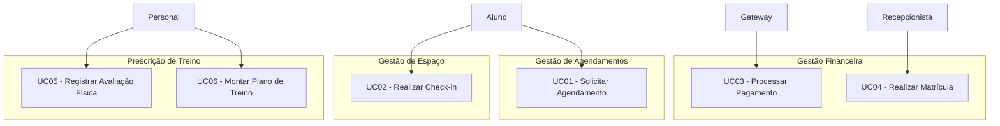
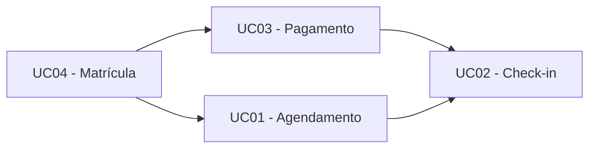
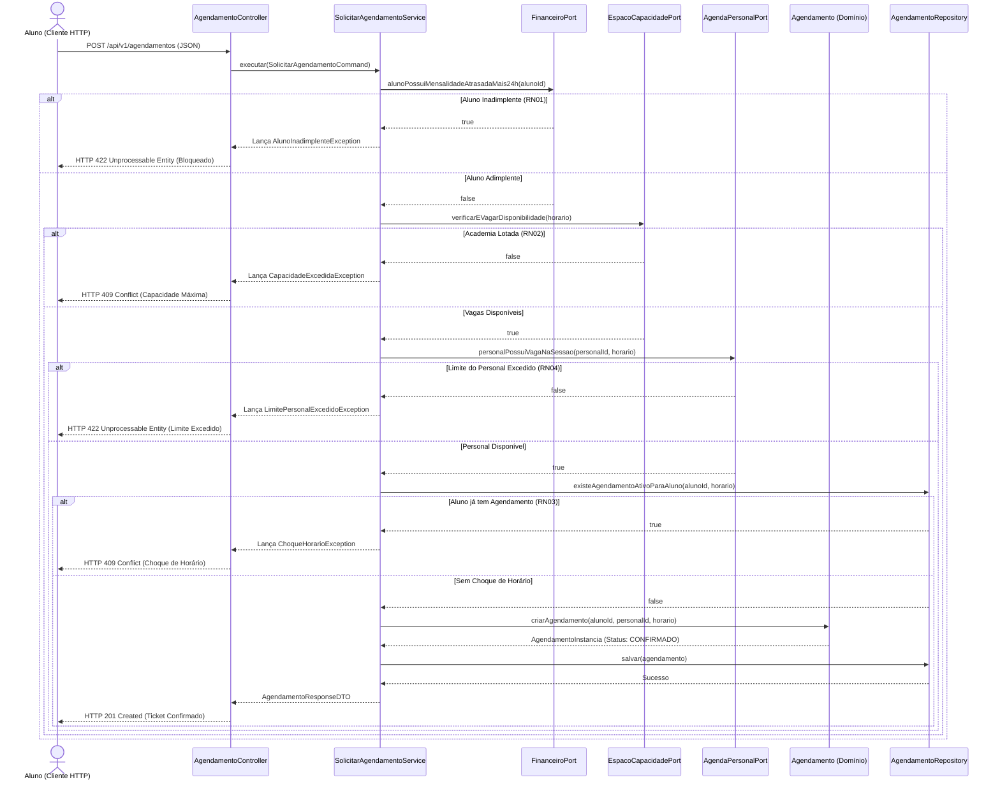
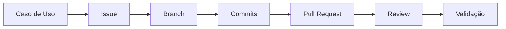

# Trabalho — Do Caso de Uso ao Primeiro Slice: Blueprint de Implementação do Sistema

## Sistema de Gestão de Academias e Personal Trainers

**Grupo:** *Eu Quero, Eu Posso*.
**Integrantes:** Mariana Veiga e Vitor Thomé.
**Tema escolhido:** Sistema de gestão de academias e personal trainers.
**Disciplina:** Desenvolvimento de Sistemas Corporativos.
**Data:** 21/10/2026.

## ETAPA 1 — Retomada do sistema

- **Nome do sistema:** FitVital
 
- **Problema central:** O sistema ataca dois problemas do negócio: (1) a evasão de alunos, causada pela falta de acompanhamento individualizado (dados espalhados em planilhas/cadernos) e (2) a superlotação, causada pela falta de controle em tempo real da capacidade física da academia. A perda de receita é uma consequência direta da falta de acompanhamento financeiro.

- **Público ou atores principais:** Aluno, Personal Trainer, Administrador e Recepcionista, além dos sistemas externos (Gateway de Pagamento e Catraca).

- **Objetivo principal da solução:** Centralizar a gestão de alunos e automatizar o controle de acesso e agendamento, otimizando o acompanhamento físico e financeiro para reter alunos e organizar a ocupação do espaço.

- **Principais conceitos do domínio já identificados:** Aluno, Agendamento, Mensalidade, Personal Trainer e Horário.

- **Principais Regras de Negócio já conhecidas:** Bloqueio de acesso e novos agendamentos se houver mensalidade atrasada há mais de 24h (RN01); Agendamentos não podem exceder a lotação máxima da academia (RN02); O aluno não pode reservar dois treinos no mesmo horário (RN03).

- **Principais decisões arquiteturais já assumidas:** Adoção de um Monólito Modular (devido à equipe pequena e domínio em evolução), dividido em 4 Bounded Contexts (Gestão Financeira, Gestão de Agendamentos, Gestão da Capacidade de Espaço e Prescrição de Treino) e organizado em camadas (Apresentação, Aplicação, Domínio e Persistência).
Não reproduza integralmente documentos anteriores.

---

## ETAPA 2 — Atores e objetivos

| Ator | Objetivo | Resultado observável |
|------|----------|----------------------|
| Aluno | Agendar treinos, acompanhar evolução, frequentar a academia | Agendamento confirmado, catraca liberada, evolução registrada |
| Personal Trainer | Prescrever treinos e gerenciar seus horários de atendimento | Treino alocado e limite de alunos por sessão respeitado |
| Administrador | Acompanhar saúde financeira e ocupação da academia | Relatórios de inadimplência e lotação visualizados |
| Recepcionista | Realizar matrículas, emitir recibos e liberar acesso manual (exceção) | Matrícula efetuada e acesso liberado em contingência |
| Gateway de Pagamento (secundário) | Processar a cobrança de mensalidades | Status de pagamento (Pago/Falha) enviado ao sistema |
| Sistema de Controle de Acesso (secundário) | Validar status do aluno e contar ocupantes | Catraca física liberada ou bloqueada (com contagem em tempo real) |

---

## ETAPA 3 — Identificação e revisão dos Casos de Uso

| ID | Caso de Uso | Ator principal | Objetivo | Resultado observável | Situação |
|----|-------------|----------------|----------|----------------------|----------|
| UC01 | Solicitar Agendamento de Treino | Aluno | Reservar horário com o personal/espaço | Ticket de agendamento confirmado | Novo |
| UC02 | Realizar Check-in (Acesso)	| Aluno / Catraca |	Entrar na academia para treinar | Catraca liberada e contagem de ocupação incrementada | Novo
| UC03 | Processar Pagamento de Mensalidade | Gateway Pagamento | Quitar a fatura do aluno | Mensalidade alterada para o estado "Paga" | Novo |
| UC04 | Realizar Matrícula de Aluno | Recepcionista | Inserir o aluno no sistema | Aluno "Ativo" e 1ª mensalidade gerada | Novo |
| UC05 | Registrar Avaliação Física | Personal Trainer | Salvar métricas de evolução do aluno | Histórico físico atualizado | Novo |
| UC06 | Montar Plano de Treino | Personal Trainer | Prescrever exercícios | Ficha de treino atrelada ao aluno | Novo |

---

## ETAPA 4 — Verificação dos Casos de Uso

| Item inicialmente identificado | Classificação inicial | Classificação atual | Justificativa |
|--------------------------------|-----------------------|---------------------|---------------|
| AutenticarUsuario | Operação/UC | Requisito Transversal | É apenas uma etapa de segurança (login), não entrega valor de negócio direto ao ator. |
| ConsultarAgendaPersonal | Operação/UC | Capacidade Interna (Domínio) | É uma regra de validação que ocorre dentro do UC01 (Agendamento), não é um objetivo do ator separado. |
| ValidarSituacaoFinanceiraAluno | Operação/UC | Serviço de Domínio (Aplicação) | 	É uma checagem que orquestra a RN01 dentro do UC01, para que o aluno consiga agendar. | 
| NotificarPartesEnvolvidas | Operação/UC | Efeito Colateral (Evento) | É uma consequência (assíncrona) do UC01, não uma interação do ator principal. |

---

## ETAPA 5 — Organização dos Casos de Uso

### 5.1 Casos de Uso por ator

### 5.2 Casos de Uso por contexto ou responsabilidade



---

## ETAPA 6 — Especificação funcional dos Casos de Uso centrais

### 1. UC01 — Solicitar Agendamento de Treino
- Atores: Aluno (principal), Personal Trainer e Gateway (secundários).

### Pré-condições: 
- Aluno autenticado no sistema.

### Pós-condições: 
- Ticket de agendamento criado, vaga na academia reservada e evento AgendamentoConfirmado gerado.

### Fluxo Principal:

- Aluno solicita data e horário.
- Sistema valida se o aluno está adimplente (RN01).
- Sistema verifica a disponibilidade na agenda do personal (RN04).
- Sistema verifica a lotação máxima da academia (RN02).
- Sistema grava a reserva e notifica as partes.

### Fluxos Alternativos:

- Aluno inadimplente: Sistema cancela a solicitação e informa o bloqueio (RN01).

- Horário/Lotação indisponível: Sistema nega a reserva e sugere horários alternativos.

- Concorrência: Se outro aluno reservou no mesmo milissegundo, o sistema impede duplicidade (RN03).


### 2. UC02 — Realizar Check-in (Controle de Acesso)
- Atores: Aluno (principal), Sistema de Controle de Acesso/Catraca (secundário).

### Pré-condições: 
- Aluno se apresenta na catraca física.

### Pós-condições: 
- Catraca liberada, entrada registrada e contador de ocupação incrementado.

### Fluxo Principal:

- Aluno passa o cartão/biometria.
- Sistema consulta o status financeiro em tempo real (RN01).
- Sistema verifica se a academia está abaixo da lotação máxima (RN02).
- Catraca é liberada.

### Fluxos Alternativos:

- Inadimplente: Catraca bloqueia e exibe mensagem para procurar a recepção.

- Academia Lotada: Catraca bloqueia a entrada até que alguém saia.

### 3. UC04 — Realizar Matrícula de Aluno
- Atores: Recepcionista.

### Pré-condições: 
- Dados do novo aluno em mãos.

### Pós-condições: 
- Aluno cadastrado com status "Ativo", 1ª mensalidade gerada e vínculo com personal (se houver) estabelecido.

### Fluxo Principal:

- Recepcionista insere os dados do aluno.
- Sistema gera o registro do Aluno.
- Sistema gera automaticamente a primeira cobrança (RN05).

### Fluxos Alternativos:

- Falha na geração da cobrança: O cadastro é revertido para não criar "alunos fantasmas" (protege a Invariante da Matrícula).

---

## ETAPA 7 — Rastreabilidade com o domínio

| Caso de Uso | Conceitos do domínio | Regras relacionadas | Invariantes | Contexto/Responsabilidade |
|---|---|---|---|---|
| UC01 | Aluno, Agendamento, Academia, Personal | RN01, RN02, RN03, RN04 | Agendamentos não podem exceder a lotação. Aluno não pode ter choque de horário. | Gestão de Agendamentos (orquestra Financeiro, Espaço e Prescrição) |
| UC02 | Aluno, Mensalidade, Academia | RN01, RN02 | Aluno com mensalidade > 24h de atraso não pode entrar. Limite físico não pode ser violado. | Gestão de Espaço (depende do Financeiro)... |
| UC04 | Aluno, Mensalidade | RN05 | Aluno "Ativo" deve ter, obrigatoriamente, pelo menos 1 Mensalidade. | Gestão Financeira |

---

## ETAPA 8 — Dependências entre Casos de Uso

| Caso de Uso | Depende de | Tipo de dependência | Justificativa |
|-------------|------------|---------------------|---------------|
| UC01 | UC04 | Estado / Informação | O aluno precisa existir e estar ativo para agendar. |
| UC02 | UC03 | Estado | A catraca só libera se a mensalidade estiver paga (ou dentro do prazo de 24h). |
| UC02 | UC01 | Informação | A catraca e o agendamento compartilham o limite de lotação física. |



---

## ETAPA 9 — Priorização e MVP

| Caso de Uso | Valor central | Dependências | Risco | Pode ser adiado? | Classificação |
|-------------|---------------|--------------|-------|------------------|---------------|
| UC01 | Alto | UC04 | Alto | Não | Central |
| UC04 | Médio | Nenhuma | Baixo | Não | Secundário |
| UC02 | Alto | UC01, UC03 | Alto | Sim | Futuro |
| UC03 | Alto | Nenhuma | Médio | Sim | Secundário |

## ETAPA 10 — Escolha do primeiro slice

### Caso de Uso escolhido: UC01 — Solicitar Agendamento de Treino.

**Justificativa (por que é o primeiro slice?):**

- Valor: É o que ataca diretamente a evasão (falta de acompanhamento).
- Representatividade: O Agendamento é o orquestrador perfeito. Para ele funcionar, ele precisa se comunicar com a Gestão Financeira (validar adimplência), com a Gestão de Espaço (validar lotação) e com a Prescrição (validar limite do personal).
- Por que não o Check-in (Catraca)? O Check-in exige um hardware externo que não temos e cujo comportamento de rede pode atrasar a implementação prática.
- **Por que não a Matrícula?** É apenas um CRUD básico no início e não testa a arquitetura de integração entre contextos.

### Entra no slice

- Aluno solicita horário.
- Validação das regras de negócio RN01 (Financeiro), RN02 (Espaço) e RN04 (Prescrição).
- Gravação do Agendamento e geração do evento AgendamentoConfirmado.

### Não entra no slice

- Integração real com o Gateway de Pagamento (o status financeiro virá de um mock/banco de dados).
- Integração com a catraca física.
- Envio de notificações reais por WhatsApp/E-mail (será apenas um log no sistema).

---

## ETAPA 11 — Linguagem ubíqua do slice

Liste os termos que deverão manter significado consistente durante a futura implementação.

| Termo | Significado no sistema | Termos que não devem ser usados como sinônimo sem justificativa |
|-------|---|---|
| Aluno | Usuário que contrata o serviço e consome as aulas/treinos. | Cliente, Usuário, Paciente |
| Personal Trainer | Profissional que prescreve e acompanha o treino. | Instrutor, Professor, Treinador |
| Agendamento | Reserva nominal de um slot de tempo para um aluno treinar. | Reserva, Horário, Aula, Ticket |
| Mensalidade | Fatura com ciclo de vida que dita a adimplência do aluno. | Pagamento, Fatura, Plano, Boleto |
| Inadimplência | Estado do aluno que possui mensalidade atrasada há mais de 24h. | Bloqueio, Devedor, Caloteiro |
| Horário (VO) | Objeto imutável que representa a janela de tempo (Data, Início, Fim). | Data, Período, Slot |

---

## ETAPA 12 — Regra central e comportamento do domínio

**Qual regra central precisa ser protegida?**
A garantia de que um agendamento só será confirmado se o aluno for adimplente, se houver vaga na academia e se o horário do personal estiver livre (RN01, RN02, RN03, RN04). A mais crítica é a não superlotação e a concorrência (dois alunos na mesma vaga).

**Qual conceito do domínio conhece essa regra?**
A entidade Agendamento (junto com o Aluno e o Espaço).

**Que alteração NÃO deveria ocorrer por simples atribuição?**
O status do agendamento não deve ser alterado por um simples agendamento.status = "CONFIRMADO" vindo do Controller.

**Como o domínio deve expressar o comportamento:**
O domínio deve ter um método de negócio que proteja a invariante. O código deve contar a história do negócio:

***Evitar:***

```text
agendamento.status = "CONFIRMADO";
```

***Preferir conceitualmente:***

```text
agendamento.confirmar(aluno, disponibilidadeEspaco, agendaPersonal);
```

---

## ETAPA 13 — Responsabilidades arquiteturais

Decomponha o Caso de Uso em responsabilidades.

| Responsabilidade | Papel arquitetural | Quem deverá assumi-la? | Justificativa |
|------------------|--------------------|------------------------|---------------|
| Receber solicitação | Fronteira | AgendamentoController (HTTP) | Recebe o JSON com id_aluno, id_personal, data e traduz para um comando da aplicação. |
| Coordenar Caso de Uso | Aplicação | SolicitarAgendamentoService | Orquestra a chamada para os contextos Financeiro e Espaço antes de invocar o Domínio. Não decide regra. |
| Decidir Regra de Negócio | Domínio | Entidade Agendamento e Aluno | O domínio avalia se o aluno está apto (RN01) e se o horário é válido (RN03), protegendo as invariantes. |
| Obter informação | Aplicação / porta | FinanceiroPort e EspacoPort | Interfaces (contratos) que o Service usa para perguntar "O aluno está pago?" e "A academia tem vaga?". |
| Persistir estado | Porta / infraestrutura | AgendamentoRepository | Interface para salvar o Agendamento. A implementação real (banco de dados) fica isolada na Infraestrutura. |
| Traduzir resultado | Fronteira | AgendamentoController | Pega o sucesso do domínio (ou a exceção) e converte em HTTP 201 (Created) ou HTTP 409 (Conflict). |

---

## ETAPA 14 — Modelo mínimo necessário ao slice

Para sustentar o UC01 — Solicitar Agendamento de Treino, é necessário isolar o modelo de domínio estritamente ao comportamento de efetivação de uma reserva nominal, reutilizando e refinando os conceitos já mapeados no Modelo Conceitual e na Arquitetura.

**Conceitos existentes e reutilizados**

* **Aluno (Entidade / Raiz do Agregado no contexto de Alunos):** Reutilizado para identificar nominalmente o requisitante. Precisa expor seu statusMatricula e o comportamento de checagem de adimplência.
* **PersonalTrainerParticular (Entidade / Raiz no contexto de Prescrição):** Reutilizado para verificar a agenda do profissional e o limite de acompanhamento simultâneo por sessão (RN04).
* **Horario (Objeto de Valor - VO):** Reutilizado para agrupar de forma imutável Data, HoraInicio e HoraFim. Usado para validar choques de horários (RN03).

**Conceitos refinados ou criados para este slice**

* **Agendamento (Entidade / Raiz do Agregado no contexto de Agendamento):** Refinado para conter a lógica de transição para o estado Confirmado. Deve encapsular a invariante de criação nominal.
* **DisponibilidadeDaAcademia (Estado / Consulta no contexto de Espaço):** Refinado como uma projeção de leitura que informa o total de agendamentos ativos em determinado Horario vs. a LotacaoMaxima (RN02).

**Comportamentos e estados necessários**

* **Estados conhecidos:** Agendamento deve transitar de Solicitado → Confirmado ou Recusado.
* **Comportamentos no Domínio:**
Aluno.validarAdimplencia() (garante a regra RN01). 
Agendamento.confirmar(aluno, disponibilidadeEspaco, agendaPersonal) (garante as invariantes de concorrência e lotação). 

**Elementos desconsiderados neste recorte**

* Maquinaria completa de cobrança e gateways externos de pagamento (a verificação do status da Mensalidade ocorrerá via dublê/mock no repositório do contexto financeiro).
* Integração física com o hardware da Catraca.
* Gestão de avaliações físicas e evolução do aluno

---

## ETAPA 15 — Portas e dependências externas

O núcleo da aplicação (Serviço de Aplicação) coordena o caso de uso chamando interfaces (Portas) para buscar informações de outros contextos antes de invocar as regras de domínio.

| Porta / contrato | Necessidade expressa | Operações realmente necessárias | Quem dependerá dela? |
|------------------|----------------------|---------------------------------|----------------------|
| FinanceiroPort | Verificar se o aluno cumpre os requisitos de adimplência sem acoplar a infraestrutura de pagamento. | alunoPossuiMensalidadeAtrasadaMais24h(alunoId: UUID): boolean | SolicitarAgendamentoService |
| EspacoCapacidadePort | Verificar e reservar vaga na lotação física global da academia (RN02). | verificarEVagarDisponibilidade(horario: Horario): boolean | SolicitarAgendamentoService |
| AgendaPersonalPort | Verificar se o Personal Trainer Particular ultrapassou o limite X de alunos por sessão (RN04). | personalPossuiVagaNaSessao(personalId: UUID, horario: Horario): boolean | SolicitarAgendamentoService |
| AgendamentoRepository | Persistir a nova entidade Agendamento confirmada e verificar concorrência nominal do mesmo aluno (RN03) | salvar(agendamento: Agendamento): void existeAgendamentoAtivoParaAluno(alunoId: UUID, horario: Horario): boolean | SolicitarAgendamentoService |

---

## ETAPA 16 — Planejamento da interface HTTP

A interface HTTP atuará estritamente como um adaptador de entrada (Fronteira), traduzindo a requisição do cliente para um Comando executável pela camada de aplicação.

* **Método:** POST
* **Rota:** /api/v1/agendamentos
* **Parâmetros de Cabeçalho:** Content-Type: application/json, Authorization: Bearer <token_aluno>
* **Corpo da Requisição (JSON):**

```
{
    "personalTrainerId": "a3b8e912-7c3d-4211-92fa-109283728192",
    "data": "2026-11-03",
    "horaInicio": "08:00",
    "horaFim": "09:00"
}
```
(Nota: O alunoId é extraído com segurança a partir do Token JWT de autenticação).

**Resultados Esperados:**

* 201 Created: Agendamento confirmado com sucesso. Retorna DTO com ID do ticket, status "CONFIRMADO" e detalhes do horário.
* 400 Bad Request: Dados de entrada inválidos (formato de data/hora incorreto).
* 409 Conflict: Violação das regras de negócio RN02 (Academia lotada) ou RN03 (Concorrência nominal do mesmo aluno no horário).
* 422 Unprocessable Entity: Violação da regra RN01 (Aluno inadimplente há mais de 24h) ou RN04 (Limite da sessão do personal excedido). 

---

## ETAPA 17 — DTO, Command e Query

| Artefato | Responsabilidade | Transporte / Intenção | Fronteira Real |
|------------------|----------------------|---------------------------------|----------------------|
| SolicitarAgendamentoRequestDTO | Deserializar o JSON recebido no Controller HTTP. | Transporta dados puros de fora para dentro da aplicação. | HTTP Controller → Application Service |
| SolicitarAgendamentoCommand | Representa a intenção explícita de alteração de estado no sistema (Create/Update). Imutável. | Expressa a intenção do ator: "Agendar Treino com estes parâmetros". | Controller → SolicitarAgendamentoService |
| AgendamentoResponseDTO | Serializar a resposta de sucesso em JSON para o cliente. | Transporta dados formatados sem expor entidades do domínio. | Application Service → HTTP Controller → Cliente  |

**Justificativa:** O Command isola a intenção de negócio das idiossincrasias do framework HTTP (como os decorators do NestJS e as validações do class-validator), enquanto as Entidades de Domínio permanecem protegidas contendo métodos comportamentais e invariantes.

---

## ETAPA 18 — Planejamento da persistência

**Informações necessárias**

* **Recuperar:** Verificar se já existe agendamento ativo para o alunoId no mesmo Horario (RN03) e obter os parâmetros de lotação.
* **Persistir:** A nova instância da entidade Agendamento com status CONFIRMADO, associando o ID do Aluno, ID do Personal, ID da Academia e o Objeto de Valor Horario.

**Isolamento arquitetural**

* A interface AgendamentoRepository ficará contida na camada de Aplicação/Domínio, expressando métodos orientados ao negócio.
* A implementação concreta utilizando ORM e conexões de banco de dados SQL ficará totalmente contida na camada de Infraestrutura.
* Independência do modelo: As entidades DDD não conterão anotações diretas de ORM (como @Entity ou @Table). Mapeadores (Mappers) na Infraestrutura farão a tradução bidirecional entre Entidades do Domínio e Tabelas/Schemas do Banco de Dados. 

---

## ETAPA 19 — Planejamento de ORM, PostgreSQL e Docker

### ORM

* **Problema técnico a resolver:** Mapear o ciclo de vida transacional das entidades e automatizar operações SQL, abstraindo consultas repetitivas.
* **Isolamento:** Ficará restrito aos adaptadores de persistência da camada de Infraestrutura. Nenhuma classe de Domínio ou Serviço de Aplicação conhecerá o ORM.

### PostgreSQL

* **Necessidade concreta:** Garantir a sobrevivência durável dos dados de agendamento e suportar locks transacionais (SELECT FOR UPDATE) para evitar condições de corrida (race conditions) em acessos simultâneos à última vaga da academia.
* **Isolamento de conceitos:** Os conceitos fundamentais como regras de inadimplência (RN01) ou integridade do ticket nominal (RN03) serão validados em memória no Domínio e independentes do mecanismo SQL.

### Docker

* **Necessidade operacional:** Prover um ambiente padronizado, isolado e facilmente reproduzível por qualquer membro da equipe para execução do banco de dados PostgreSQL e serviços do monólito sem dependência de instalações locais complexas.
* **Serviços no ambiente:** Container para a Aplicação (Node.js / NestJS) e container para o Banco de Dados (PostgreSQL).

---

## ETAPA 20 — Resultados e falhas

| Situação | Categoria | Quem deverá identificar? | Significado interno | Possível tradução HTTP futura |
|----------|-----------|--------------------------|---------------------|-------------------------------|
| Agendamento criado com sucesso | Sucesso | Domínio / Aplicação | Invariantes atendidas e estado alterado para Confirmado. | 201 Created |
| Aluno com mensalidade atrasada há > 24h | Violação de Domínio | FinanceiroPort / Domínio | O aluno feriu a regra RN01 e está impedido de reservar. | 422 Unprocessable Entity |
| Academia em capacidade máxima no horário | Violação de Domínio | EspacoCapacidadePort / Domínio | Imposto pela regra RN02 (invariante de lotação física). | 409 Conflict |
| Aluno tentou reservar 2x no mesmo horário | Violação de Domínio | AgendamentoRepository / Domínio | Imposto pela regra RN04 (capacidade do personal). | 409 Conflict |
| Limite de alunos da sessão do personal excedido | Violação de Domínio | AgendaPersonalPort / Domínio | Imposto pela regra RN04 (capacidade do personal). | 422 Unprocessable Entity |
| Banco de Dados indisponível | Falha de Infraestrutura | Adapters de Persistência | A execução técnica foi interrompida na camada infra. | 500 Internal Server Error |

---

## ETAPA 21 — Fluxo arquitetural planejado

Represente o fluxo futuro do slice utilizando Mermaid.



---

## ETAPA 22 — Blueprint de implementação

Construa um plano ordenado de implementação futura.

Sugestão de estrutura:

| Ordem | Passo | Objetivo | Dependência |
|-------|-------|----------|-------------|
| 1 | Consolidar Caso de Uso | Fixar contrato de entrada, saídas e limites do UC01 sem ambiguidade. | Nenhuma |
| 2 | Refinar domínio mínimo | Implementar Agendamento, Horario e comportamentos puros no Domínio. | Passo 1 |
| 3 | Definir coordenação da aplicação | Criar os contratos FinanceiroPort, EspacoCapacidadePort e AgendamentoRepository na camada interna. | Passo 2 |
| 4 | Definir portas | Desenvolver o SolicitarAgendamentoService orquestrando as validações e salvar. | Passo 3 |
| 5 | Planejar interface HTTP | Criar DTOs, AgendamentoController e mapeadores de exceção HTTP. | Passo 4 |
| 6 | Planejar persistência | Criar repositórios em memória ou adapters simulados para validação rápida sem banco real. | Passo 4 |
| 7 | Planejar infraestrutura | Criar mapeamentos de ORM, entidades SQL e conectores do PostgreSQL. | Passo 6 |
| 8 | Planejar validação | Testar os fluxos feliz e alternativos (falhas de RN01, RN02, RN03). | Passo 7 |

---

## ETAPA 23 — Planejamento de validação

**O que e como verificar futuramente**

* **No Domínio:** Testes unitários puros na entidade Agendamento e VO Horario. Garantir que tentativas de criar agendamentos com parâmetros nulos ou inválidos disparam exceções de domínio.
* **Na Aplicação:** Testes de serviço utilizando dublês (mocks) para as Portas (FinanceiroPort, EspacoCapacidadePort). Verificar se o SolicitarAgendamentoService interrompe o fluxo imediatamente quando o aluno está inadimplente (RN01) ou se a academia está lotada (RN02).
* **Na Interface HTTP:** Testes de integração nos Controllers (MockMvc/RestAssured). Mapear os retornos corretos de status HTTP (201, 409, 422) e validar se a estrutura do JSON de resposta segue o AgendamentoResponseDTO.
* **Na Persistência:** Testes de repositório com banco de dados em memória ou container de teste (Testcontainers). Validar se o método existeAgendamentoAtivoParaAluno realmente bloqueia reservas simultâneas no mesmo horário (RN03). 

---

## ETAPA 24 — Governança futura da implementação

O fluxo de desenvolvimento manterá rastreabilidade direta do Caso de Uso até a entrega:



1. **Issue:** Criada no GitHub/GitLab mapeada como [UC01] Implementação do Slice de Agendamento.
2. **Branch:** Criada a partir da main seguindo a convenção feature/uc01-solicitar-agendamento.
3. **Commits:** Mensagens padronizadas fazendo referência direta ao requisito e etapa, ex: feat(agendamento): adiciona validacao da RN01 no service.
4. **Pull Request (PR):** Aberto contra a main contendo o checklist de validação (testes de domínio, aplicação e HTTP passando).
5. **Review:** Pelo menos 1 integrante da equipe deve revisar o código garantindo que as regras DDD e o isolamento de camadas foram respeitados.
6. **Validação:** Aprovação do PR e execução da pipeline de CI/CD para merge definitivo na branch principal. 

---

## ETAPA 25 — Revisões descobertas nesta atividade

Registre alterações ou dúvidas que surgiram.

| Conhecimento anterior | Descoberta atual | Revisão necessária | Impacto |
|-----------------------|------------------|--------------------|---------|
| O Agendamento consultaria o Banco de Dados Financeiro diretamente. | Viola a autonomia do Monólito Modular. O contexto de Agendamentos não deve acessar tabelas de cobrança diretamente. | Criação do contrato desacoplado FinanceiroPort. | Redução do acoplamento técnico e preservação da arquitetura modular. |
| A lotação da academia era tratada como um atributo estático do cadastro. | A lotação disponível varia dinamicamente a cada janela de Horario. | Isolamento da verificação no contexto de Gestão de Espaço (EspacoCapacidadePort). | Necessidade de controle de concorrência por janela de tempo. |

---

## ETAPA 26 — Pendências de governança

| Artefato / documento | Alteração necessária | Motivo | Prioridade |
|----------------------|----------------------|--------|------------|
| Dicionário de Linguagem Ubíqua | Incluir a definição explícita do termo Command e formalizar os status transacionais do Agendamento. | Evitar ambiguidades conceituais entre desenvolvedores ao implementar o código. | Média |
| Especificação Técnica do Bounded Context de Espaço | Definir o mecanismo técnico de Lock (otimista ou pessimista) para a porta EspacoCapacidadePort. | Proteger a invariante RN02 contra condições de corrida (race conditions) em acessos simultâneos. | Alta |
| Documento de Casos de Uso | Atualizar a especificação do UC01 indicando explicitamente a interrupção por falha da RN04 (Limite do Personal). | Manter a documentação funcional alinhada com as descobertas arquiteturais. | Média |

---

## ETAPA 27 — Reflexão crítica

Responda:

- O Caso de Uso selecionado representa valor real para o ator?
Sim, o UC01 resolve o problema central de acompanhamento do aluno e organização das vagas, atacando a causa principal da evasão no negócio.
- O comportamento continuaria fazendo sentido sem HTTP?
Perfeitamente. Toda a orquestração (SolicitarAgendamentoService) e as regras de negócio (RN01 a RN04) funcionam e podem ser testadas sem qualquer dependência de Web ou Controllers.
- Qual é a principal Regra de Negócio do slice?
A não superlotação do espaço físico (RN02) e o bloqueio por inadimplência (RN01). A aplicação coordena a checagem através das portas, enquanto as Entidades do Domínio garantem as invariantes de estado.
- Quem deverá protegê-la?
A coordenação da verificação é feita pelo Serviço de Aplicação (SolicitarAgendamentoService) através de Portas de integração, mas as Entidades de Domínio (como Agendamento) e o repositório protegem ativamente as invariantes estruturais e o estado consistente.
- Qual parte deverá apenas coordenar?
A camada de Aplicação (SolicitarAgendamentoService), que não decide regras de negócio, mas chama as portas e o domínio na ordem correta.
- Que dependências externas serão necessárias?
Neste primeiro slice, nenhuma dependência física real. As integrações com Catraca e Gateway de Pagamento serão simuladas por Mocks via Portas.
- Algum artefato técnico inicialmente imaginado mostrou-se desnecessário?
Sim, a criação antecipada de filas de mensageria assíncrona (RabbitMQ/Kafka) para notificar o aluno. O fluxo síncrono atende com simplicidade no Monólito Modular.
- Alguma responsabilidade estava posicionada incorretamente?
Sim. Inicialmente havia a suposição de que o contexto de agendamentos poderia consultar tabelas de outros contextos livremente. A responsabilidade foi reposicionada para contratos estritos via Portas (FinanceiroPort, EspacoCapacidadePort), preservando os limites do Monólito Modular.
- Qual falha foi mais difícil de classificar?
A rejeição por falta de vagas no horário (RN02). Ela é um impedimento de domínio com viés situacional/dinâmico e não um erro de aplicação.
- A persistência influenciou indevidamente o modelo em algum momento?
Não. O modelo foi guiado estritamente pelos comportamentos do negócio, mantendo as tabelas do PostgreSQL e anotações do ORM estritamente isoladas na Infraestrutura.
- O que este trabalho revelou que a modelagem anterior ainda não mostrava?
Revelou a real necessidade de abstrair as fronteiras entre os Bounded Contexts através de Portas (Interfaces), garantindo que o módulo de Agendamento não acesse as tabelas do Financeiro diretamente.
- Que documentação anterior deverá ser revisada?
O Dicionário de Linguagem Ubíqua (para incluir o termo Command), a especificação detalhada do caso de uso UC01 e o mapeamento de contratos de portas entre os Bounded Contexts.
- A equipe considera o blueprint suficientemente claro para orientar uma implementação futura? Por quê?
Sim. O plano traçou detalhadamente o caminho desde a intenção do cliente HTTP, passando pelos DTOs e Commands, até a coordenação do domínio, contratos de portas e estratégia de persistência, fornecendo um roteiro inequívoco para o desenvolvimento do código.

---

## Apêndice — Uso de Inteligência Artificial

### Ferramenta utilizada
- Deepseek e Gemini

### Finalidade
A IA foi utilizada como uma "advogada do diabo" e revisora arquitetural. O objetivo principal foi questionar as decisões já tomadas nos trabalhos anteriores (1 a 5), ajudar a destrinchar as cadeias causais dos problemas do domínio (evasão e lotação) e estruturar o blueprint de implementação, garantindo que as regras de negócio não fossem perdidas.

### Principais contribuições
- **Desconstrução dos problemas:** Ajudou a refinar a definição do problema central. Separou o que era sintoma (planilhas espalhadas), consequência (perda de receita) e problemas reais (evasão e superlotação por falta de controle em tempo real).
- **Estruturação do Blueprint:** Auxiliou na organização das tabelas e na garantia de que todas as etapas do trabalho estivessem conectadas de forma lógica.
- **Refinamento do Escopo:** Ajudou a identificar que a Catraca (UC02) e o Pagamento real (UC03) não deveriam entrar no primeiro slice para não comprometer a entrega ágil.

### Hipóteses reveladas
- A percepção de que a **lotação** não é causada pela "informação espalhada" (que é o problema da evasão), mas sim pela **falta de controle em tempo real**.
- A confirmação de que a **perda de receita** é uma consequência do gerenciamento bagunçado, e não um problema isolado do sistema.

### Decisões questionadas
- A escolha do primeiro slice. A IA questionou se não deveria ser o Check-in (Catraca) pela criticidade do controle de acesso, mas a equipe decidiu manter o Agendamento (UC01) por ser o orquestrador central e não depender de hardware físico imediato.
- A definição de onde ficaria a regra de lotação (RN02). A IA ajudou a validar a decisão do Trabalho 5 de tirar essa responsabilidade do Agendamento e deixá-la no contexto de Gestão de Espaço.

### Sugestões rejeitadas
- **Entrega pronta:** A IA inicialmente sugeriu estruturas genéricas de blueprint. A equipe rejeitou o "texto pronto" e exigiu que a IA atuasse de forma socrática, fazendo perguntas para que a própria equipe formulasse as respostas.
- **Retirar o foco no aluno:** A IA sugeriu focar o slice apenas em validações técnicas (financeiro/lotação), mas a equipe manteve o foco no objetivo do ator (Aluno), garantindo que o comportamento fizesse sentido sem HTTP.

### Avaliação crítica
- **Onde a IA ajudou?** Na organização estrutural do documento, na revisão de coerência entre os 5 trabalhos anteriores e na redação de diagramas Mermaid.
- **Onde apresentou limitações?** A IA não conhece a realidade operacional de uma academia (ex.: a dinâmica da recepção e as brechas da catraca). Foi necessário que a equipe aplicasse o conhecimento empírico de domínio para validar as sugestões.
- **Tentou inventar informações?** Em alguns momentos, tentou preencher lacunas com regras genéricas de mercado que não estavam nos trabalhos anteriores. A equipe corrigiu essas alucinações cortando o que não tinha evidência documental.
- **Sugeriu decisões técnicas prematuras?** Sim, como a implementação de mensageria (Kafka/RabbitMQ) para o check-in. A equipe rejeitou, mantendo a decisão do Trabalho 5 de usar um Monólito Modular com comunicação síncrona.
- **Como a equipe verificou as sugestões?** Todas as sugestões da IA foram confrontadas com as regras de negócio (RN01 a RN05) e com os Bounded Contexts estabelecidos no Trabalho 5. Se não tivesse lastro na nossa documentação, era descartada.

### Questão final obrigatória
**Se a IA fosse retirada agora, a equipe conseguiria explicar e defender o Caso de Uso, o blueprint, as responsabilidades e todas as decisões registradas?**
Sim. A IA foi utilizada estritamente como uma ferramenta de estruturação e questionamento. As decisões de escopo (o que entra e o que não entra no slice), a escolha do UC01 como orquestrador e a própria definição da cadeia causal do problema (evasão e lotação) partiram do raciocínio ativo da equipe. Sabemos justificar cada escolha arquitetural porque fomos nós que respondemos às perguntas críticas para construir o modelo.

