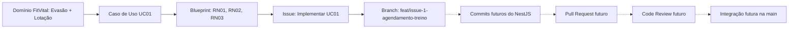

# Trabalho - Preparação e Governança do Repositório para o Primeiro Slice

## Sistema de Gestão de Academias e Personal Trainers
**Grupo:** *Eu Quero, Eu Posso*.
**Integrantes:** Mariana Veiga e Vitor Thomé.
**Tema escolhido:** Sistema de gestão de academias e personal trainers.
**Disciplina:** Desenvolvimento de Sistemas Corporativos.
**Data:** 25/10/2026.

---

### Etapa A — Identificação do projeto e do primeiro slice
O **FitVital** resolve dois problemas centrais em academias: a **evasão de alunos** causada pela falta de acompanhamento individualizado devido a dados espalhados e a **superlotação** causada pela falta de controle em tempo real da capacidade física. O sistema visa centralizar dados e automatizar agendamentos e acessos.

O **primeiro slice** foca no **UC01 - Solicitar Agendamento de Treino**, permitindo que o aluno reserve um horário, garantindo que as regras de adimplência, lotação e disponibilidade sejam respeitadas pelo domínio, sem a necessidade de integrações reais com hardware (catraca) ou Gateway de Pagamento neste primeiro momento.

| Elemento | Informação do projeto | Origem na documentação anterior |
|----------|-----------------------|---------------------------------|
| Sistema | FitVital (Equipe: Eu Quero, Eu Posso - Mariana e Vitor) | Trabalho 1 (Arquitetura Inicial) |
| Caso de Uso | UC01 - Solicitar Agendamento de Treino | Blueprint do Primeiro Slice (Etapa 10) |
| Regra central | Validar adimplência (RN01), lotação da academia (RN02) e choque de horário (RN03) antes de confirmar a reserva. | Trabalho 4 (Modelagem de Domínio) e Blueprint (Etapa 12) |
| Conceito principal do domínio | Entidade Agendamento (interagindo com Aluno, Academia e Horário).	| Trabalho 4 (Modelagem de Domínio) |
| Limites do primeiro slice | Não inclui integração com a catraca física nem Gateway de Pagamento real (serão usados mocks). O foco é a orquestração e as regras de domínio do agendamento.	| Blueprint do Primeiro Slice (Etapa 10) |

---

### Etapa B — Organização e repositório no GitHub (execução prática)

- **Link da Organization:** https://github.com/FitVital-DSC.
- **Link do Repositório:** https://github.com/FitVital-DSC/FitVital.
- **Branch principal:** main.
- **Visibilidade:** Pública.

#### Por que o repositório é um ativo do projeto?
O repositório deve ser considerado um ativo do projeto porque ele não guarda apenas código, mas sim a fonte da verdade e a memória do projeto. É nele que ficam registradas a documentação de domínio (visao-geral.md), as decisões arquiteturais (Bounded Contexts) e a rastreabilidade do que precisa ser feito (Issues e Branches). Ao centralizar tudo isso em uma Organization, garantimos que o conhecimento não fique preso na conta pessoal de um único desenvolvedor, permitindo que a equipe evolua o sistema de forma governada e rastreável.

---

### Etapa C — Documentação inicial no repositório (execução prática)

- **/README.md:** https://github.com/FitVital-DSC/FitVital/blob/main/README.md.
- **/docs/visao-geral.md:** https://github.com/FitVital-DSC/FitVital/blob/main/docs/visao-geral.md.
- **/.gitignore:** https://github.com/FitVital-DSC/FitVital/blob/main/.gitignore.
- **/.env.example:** https://github.com/FitVital-DSC/FitVital/blob/main/fitvital-backend/.env.example.

#### Análise breve:
Alguém de fora da equipe consegueria compreender o sistema, seu estágio e o próximo passo. O README.md atua como a porta de entrada, informando o propósito do FitVital, quem são os responsáveis, a stack prevista e qual é o foco do primeiro slice, deixando claro o que já foi feito e o que é apenas planejamento. O docs/visao-geral.md aprofunda o contexto do domínio, detalhando os 4 Bounded Contexts e as regras de negócio, garantindo que a arquitetura seja compreendida. Por fim, o .gitignore configurado para NestJS e o .env.example demonstram que o projeto já possui uma preocupação com a segurança de dados sensíveis desde a concepção.

---

### Etapa D — Git local e histórico (execução prática)

| Ação real | Evidência ou referência | O que demonstra |
|-----------|-------------------------|-----------------|
| Trabalho local / `git status` | O terminal apontou o README.md como modificado e o docs/visao-geral.md como um novo arquivo não rastreado | Demonstra a alteração no ambiente de desenvolvimento antes do envio, permitindo revisar o que será salvo. |
| Preparação das alterações / staging | Comando git add . | Move as alterações da área de trabalho para a staging area, preparando-as para compor o próximo pacote de mudanças. |
| Commit de documentação | Hash: d3a4188b88ee7a5c1e1a9f91692aba72875fdaef | Registra no histórico local a criação da visão geral e atualização do README com uma mensagem clara e semântica. |
| Publicação no remoto | https://github.com/FitVital-DSC/FitVital/commit/d3a4188b88ee7a5c1e1a9f91692aba72875fdaef | Sincroniza o histórico local com o servidor (GitHub), garantindo que a equipe e o professor tenham acesso à versão atualizada. |

### Explique a diferença entre editar um arquivo, prepará-lo com `git add`, registrar com `git commit` e publicar com `git push`. Qualidade e coerência do histórico valem mais que quantidade de commits.
- **Editar:** É a ação física de modificar ou criar um arquivo no computador. O Git sabe que o arquivo mudou, mas não sabe se você quer salvar essa mudança no histórico oficial.
- **git add (Preparar):** É avisar ao Git: "Separe essas mudanças específicas, pois elas farão parte do meu próximo ponto no histórico".
- **git commit (Registrar):** É a ação de registrar as mudanças e colocá-las no histórico local, acompanhadas de uma mensagem explicativa.
- **git push (Publicar):** É enviar os registros (commits) locais para o servidor remoto (GitHub). Sem o push, o código fica apenas na máquina.

Qualidade e coerência do histórico valem mais que quantidade: commits bem descritos contam a história do projeto e facilitam a revisão de código no futuro.

---

### Etapa E — Colaboração e permissões (execução prática e justificativa)

| Membro ou Team | Função | Acesso concedido ou necessário | Justificativa |
|----------------|--------|--------------------------------|---------------|
| Mariana | Criadora da Organização (Owner) | Admin | Responsável pela criação da Organization, configuração do repositório e gestão de acessos. |
| Vitor	| Desenvolvedor (Member) | Write | Precisa de permissão para fazer commits, criar branches e enviar código para o repositório, mas não precisa de permissão para deletar o projeto. |
| Professor | Revisor | Read | Como o repositório é público, o professor não precisa ser adicionado como colaborador. Ele tem acesso de leitura global (Read) para avaliar o código, a documentação e as Issues. |

---

### Etapa F — Issue vinculada ao primeiro slice (execução prática)

- **Link da issue:** https://github.com/FitVital-DSC/FitVital/issues/1.
- **Por que ela é uma unidade de trabalho e não a especificação?** A Issue serve como a unidade de execução, com critérios de aceite claros para os desenvolvedores. A especificação funcional e o blueprint são os documentos de conhecimento e arquitetura. A Issue aponta para a especificação, mas ela é temporária e focada na ação, enquanto o Blueprint é atemporal.

---

### Etapa G — Branch de trabalho (execução prática)

- **Nome:** feat/issue-1-agendamento-treino.
- **Link da Branch:** https://github.com/FitVital-DSC/FitVital/tree/feat/issue-1-agendamento-treino.
- **Relação com a Issue:** A branch foi criada diretamente a partir da main atualizada e carrega o número da Issue em seu nome, garantindo que o GitHub vincule automaticamente qualquer commit futuro feito nela à Issue de Agendamento.

---

### Etapa H — Planejamento do Pull Request e do Code Review

**Conteúdo do futuro Pull Request:**
- **Objetivo:** Implementar o UC01 (Solicitar Agendamento de Treino) garantindo as validações de adimplência, lotação e choque de horário.
- **Issue Relacionada:** 1.
- **Decisões relevantes:** Uso do padrão NestJS com TypeScript; separação da regra de domínio das validações de banco de dados.
- **Validação:** Testes unitários cobrindo os fluxos de exceção.
- **Limitações:** Gateway de Pagamento e Catraca serão *mocks* nesta fase.

**Por que o push não integra à main?**
O `git push` para uma branch remota apenas salva o código no servidor, mas não altera a `main`. Isso impede que código não testado quebre o sistema principal.

**Checklist de Code Review:**
| Dimensão | Pergunta de revisão relacionada ao primeiro slice |
|----------|---------------------------------------------------|
| **Domínio** | A regra de bloqueio (RN01) está na entidade `Agendamento`/`Aluno`, e não no Controller? |
| **Aplicação** | O Service está apenas orquestrando as chamadas (Financeiro/Espaço) e não decidindo a regra? |
| **Arquitetura** | As portas (interfaces) de Financeiro e Espaço foram respeitadas? |
| **Qualidade** | Os nomes das variáveis refletem a linguagem ubíqua (ex: `mensalidadeAtrasada`)? |

---

### Etapa I — Rastreabilidade do trabalho

Ao ver um trecho de código na branch, o desenvolvedor pode usar o Git Blame para achar o commit. No commit, achará a referência à Issue. Na Issue, lerá os critérios de aceite e encontrará o link para o Blueprint, entendendo que aquele código existe para proteger a RN01 (inadimplência) e evitar a evasão. Assim, a rastreabilidade do "porquê" está garantida.

---

### Etapa J — Revisões de documentação e reflexão crítica

**Revisões identificadas:**
| Artefato anterior | Revisão identificada | Justificativa | Impacto futuro |
|-------------------|----------------------|---------------|----------------|
| Modelagem de Domínio | Retirada do "Personal da Academia" do escopo do MVP e foco no Particular. | A duplicidade de papéis gerava complexidade excessiva para o primeiro slice. | O código precisará apenas da entidade `PersonalTrainerParticular`. |
| Blueprint | Definição de que a catraca (UC02) não entra no MVP. | Priorização do valor central (agendamento) sem a dependência de hardware físico. | O sistema iniciará com *mocks* para o controle de acesso, evoluindo depois. |

**Reflexão crítica:**
- **O que a organização do repositório revelou?** Que já temos uma base de código NestJS iniciada, o que nos dá um ponto de partida, mas exige disciplina para que o código não se afaste da documentação.
- **Ligação entre UC, Issue e Branch:** O UC define o comportamento; a Issue transforma em tarefa executável; a Branch isola a implementação. 
- **Por que commits claros são melhores que "final"?** O commit "final" não diz o que mudou. Commits convencionais permitem entender o histórico e voltar a partes específicas se algo quebrar.
- **Risco de alterações na main sem revisão:** Risco de quebrar a branch principal, impedindo que os outros membros baixem o código e continuem trabalhando.
- **O que falta praticar em PR/Review?** A cultura de revisar o código e a automação de CI/CD.
- **O que precisa estar pronto para outra pessoa continuar?** O `README.md`, o `docs/visao-geral.md` e a Issue com critérios de aceite.

---

## Apêndice - Uso de Inteligência Artificial

### **Ferramenta(s):** 
DeepSeek.

### **Finalidade:** 
Atuar como revisora arquitetural e "advogada do diabo" para questionar as decisões anteriores, destrinchar as cadeias causais dos problemas do domínio (evasão e lotação) e estruturar o blueprint de implementação de forma socrática (fazendo perguntas em vez de entregar respostas prontas).

### **Principais sugestões:** 
  - Ajudou a separar o sintoma (planilhas espalhadas) do problema real (evasão por falta de acompanhamento e lotação por falta de controle em tempo real).
  - Auxiliou na definição do UC01 (Agendamento) como o primeiro slice por ser o orquestrador central das regras de negócio.
  - Sugeriu a estruturação dos diagramas Mermaid e das tabelas de rastreabilidade.

### **Verificações efetuadas:** 
Todas as sugestões da IA foram confrontadas com as Regras de Negócio (RN01 a RN05) e com os Bounded Contexts definidos no Trabalho 5. Se a sugestão não tivesse lastro na documentação da equipe, era imediatamente descartada.

### **Ajustes ou sugestões rejeitadas:** 
A IA sugeriu adotar microsserviços, mas a equipe rejeitou, mantendo a decisão de um Monólito Modular com chamadas síncronas. A equipe também rejeitou a entrega de "textos prontos", exigindo que a IA formulasse perguntas para que nós mesmos construíssemos as respostas. 

### **Reflexão sobre o que foi compreendido independentemente da ferramenta:** 
A IA foi fundamental para organizar a estrutura, mas não substituiu o entendimento do negócio. A compreensão de que a evasão é um problema de informação histórica e a lotação é um problema de tempo real só foi possível porque a equipe aplicou o conhecimento prático do domínio da academia. Sabemos defender cada decisão de escopo porque fomos nós que respondemos ativamente aos questionamentos, garantindo total autonomia sobre o projeto.
