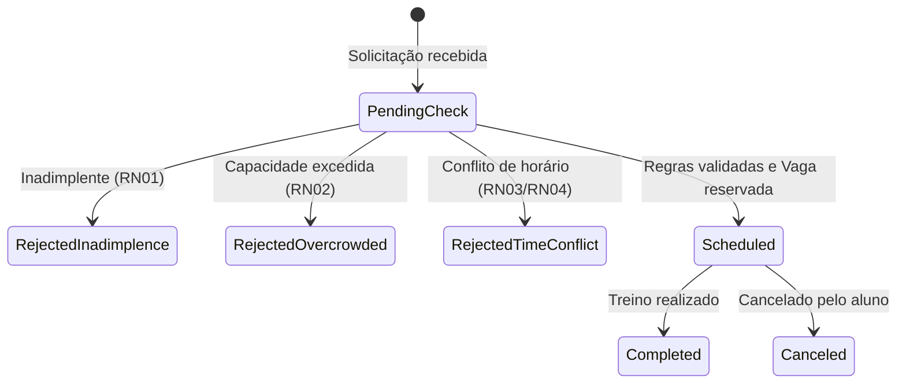
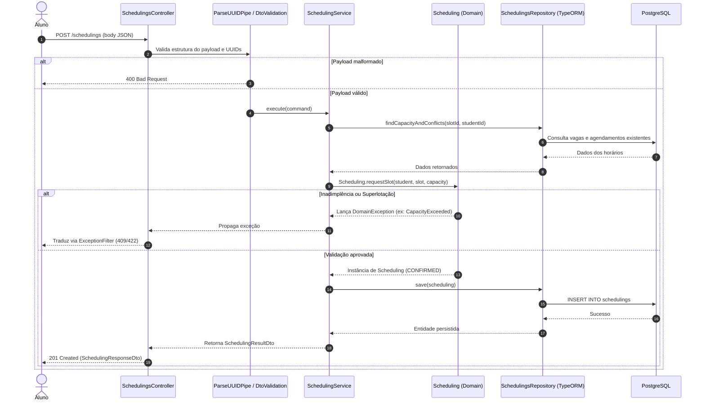

# Trabalho -- NestJS 12: Base Técnica Validada e Transição para o Primeiro Slice do Sistema

## Sistema de Gestão de Academias e Personal Trainers
**Grupo:** *Eu Quero, Eu Posso*.
**Integrantes:** Mariana Veiga e Vitor Thomé.
**Tema escolhido:** Sistema de gestão de academias e personal trainers.
**Disciplina:** Desenvolvimento de Sistemas Corporativos.
**Data:** 26/10/2026.

---

## Parte A — Preparação e execução prática do backend

### Etapa 1 — Identificação do sistema e do ponto de partida

* **Nome do sistema:** FitVital - Sistema de Gestão de Academias e Personal Trainers.

* **Responsáveis:** Mariana Veiga e Vitor Thomé.

* **Endereço da Organization:** https://github.com/FitVital-DSC.

* **Endereço do Repositório GitHub:** https://github.com/FitVital-DSC/FitVital.

* **Problema que o sistema resolve:** O sistema ataca dois problemas do negócio: 
    **1) Evasão de alunos**, causada pela falta de acompanhamento individualizado (dados espalhados em planilhas/cadernos);
    **2) Superlotação**, causada pela falta de controle em tempo real da capacidade física da academia. A perda de receita é uma consequência direta da falta de acompanhamento financeiro.

* **Público interessado:** Donos de Academia de médio porte e Personal Trainers.

* **Caso de Uso/primeiro slice já selecionado e motivo da escolha, em poucas linhas:** UC01 - Solicitar Agendamento de Treino. O motivo da escolha é que este é o fluxo central que ataca diretamente a evasão, além de orquestrar as regras críticas do domínio (adimplência, lotação e choque de horário)

* **Estágio do backend antes de iniciar este trabalho:** Parcialmente criado.

* **Sistema operacional e terminal utilizados:** Windows 11 e PowerShell.

---

### Etapa 2 — Inventário e compatibilidade do ambiente

| Ferramenta | Versão observada | Linha adotada | Compatível? | Intervenção necessária? |
| :--- | :--- | :--- | :--- | :--- |
| **Node.js** | 24.14.1 | 24, compatível com Nest CLI 12 | Sim | Não |
| **npm** | 11.11.0 | Compatível com Node.js | Sim | Não |
| **pnpm** | 12.9.1 | 12 | Sim | Não |
| **Nest CLI** | 12.0.8 | 12 | Sim | Não |

**Explique a diferença entre Node.js, npm, pnpm, TypeScript, framework NestJS e Nest CLI**. Justifique a escolha de um único gerenciador de dependências para o projeto. Não confunda a versão global da CLI com a versão do framework instalado no projeto.
O **Node.js** é o executador do código, o **NestJS** é um framework que organiza o código, **Nest CLI** é a ferramente utilizada no terminal para criar arquivos e rodar o projeto por meio do NestJS.
O **TypeScript** é uma linguagem de programação "aprimorada" do JavaScript, com o objetivo de informar os erros em tempo real e evitar bugs após a compilação. Já o **npm** e **pnpm** são gerenciadores de pacotes, a escolha de usar apenas o pnpm se justifica para evitar conflitos de lockfile (como package-lock.json e pnpm-lock.yaml). Se cada desenvolvedor usar um gerenciador diferente, as versões das bibliotecas podem divergir, causando o famoso erro de 'funciona na minha máquina, mas não na do colega'.

---

### Etapa 3 — Diagnóstico e recuperação, somente se necessário

A compatibilidade foi comprovada por meio da Etapa 2, onde verificou-se que as versões do Node.js (v24), pnpm (v12) e Nest CLI (v12) já estavam instaladas e alinhadas com as exigências da disciplina, sem a necessidade de reinstalações ou ajustes de PATH.

---

### Etapa 4 — Criação ou verificação da aplicação NestJS 12

Como a estrutura do backend (fitvital-backend) já havia sido inicializada anteriormente na disciplina, não foi necessário recriar o projeto. O procedimento adotado foi a verificação do estado real, conforme orientado.

O projeto foi gerado utilizando a CLI oficial do NestJS, e as seguintes decisões da CLI foram adotadas e confirmadas:

* **Gerenciador de pacotes:** pnpm.

* **Sistema de módulos:** ESM (identificado pelos imports com extensão .js no TypeScript).

* **Ferramenta de testes:** Vitest (configurada no package.json e arquivos .spec.ts).

* O pacote @nestjs/observe não foi configurado.

#### Diferença entre os estados de verificação:

* **Estrutura gerada:** Verificada pela presença da pasta src/, dos arquivos base (main.ts, app.module.ts) e da pasta de testes.

* **Dependências instaladas:** Comprovada pela existência da pasta node_modules e do arquivo pnpm-lock.yaml. O comando pnpm list @nestjs/core foi executado para confirmar a versão do framework.

* **Aplicação iniciada:** Verificada ao rodar o comando pnpm start:dev, que compilou o TypeScript (0 erros) e subiu o servidor NestJS na porta 3000.

* **Aplicação validada:** Comprovada pela execução dos testes unitários (Vitest) e pela resposta do servidor ao acessar a rota inicial (Hello World).

---

### Etapa 5 — Dependências, projeto e execução

Na raiz da aplicação (fitvital-backend), foram verificados os seguintes pontos:

- O package.json contém o script start:dev configurado corretamente para rodar o NestJS.

- O arquivo pnpm-lock.yaml está presente, registrando a resolução das dependências.

- A versão local do framework foi verificada rodando o comando pnpm list @nestjs/core, que retornou a versão exata: @nestjs/core@12.2.0.

**Inicialização da aplicação:**
A aplicação foi iniciada com o comando:

```bash
pnpm start:dev
```

Os logs demonstraram que a compilação ocorreu com 0 erros e que os módulos (incluindo o SchedulingModule e o TypeOrmModule) foram inicializados. A porta em uso é a 3000 e a URL de teste é http://localhost:3000/.

(Nota: Embora o banco de dados PostgreSQL esteja rodando via Docker, a aplicação NestJS roda localmente de forma independente, aguardando as requisições).

#### Por que a mensagem de inicialização não comprova a resposta HTTP?
A mensagem Nest application successfully started comprova apenas que o processo do Node.js foi executado com sucesso, o código TypeScript foi compilado e o servidor abriu a porta 3000 para escutar. No entanto, isso não comprova que a rota HTTP está configurada corretamente ou que o roteamento está respondendo. A requisição HTTP só é comprovada quando um cliente externo envia uma chamada para a porta 3000 e o servidor efetivamente devolve os dados esperados.

---

### Etapa 6 — Leitura dos arquivos gerados

Inspecione os arquivos reais da aplicação, sem precisar alterar o código, e responda:

| Arquivo | O que identificou no código? | Qual é o papel no Hello World? |
| :--- | :--- | :--- |
| `package.json` | As dependências do projeto e os scripts de execução. | Define o que precisa ser instalado e como iniciar a aplicação. |
| `src/main.ts` | A função bootstrap() que chama NestFactory.create(AppModule) e o método listen(3000). | É o ponto de partida. Ele "liga o motor" da aplicação e abre a porta 3000. |
| `src/app.module.ts` | O decorator @Module que importa e organiza o AppController e o AppService. | Agrupa e conecta as peças para o NestJS saber o que existe. |
| `src/app.controller.ts` | O decorator @Controller() e o método com @Get(). | É a porta de entrada HTTP. |
| `src/app.service.ts` | A classe @Injectable() com o método que retorna a string "Hello World!". | É a lógica de negócio (ou o serviço). Ele faz o trabalho de gerar a resposta. |

#### **Explique o caminho pelo qual a mensagem chega à resposta HTTP:** 
**1)** O servidor NestJS é iniciado pelo main.ts, abrindo a porta 3000.
**2)** O cliente (navegador) faz uma requisição GET /.
**3)** O AppController intercepta essa requisição e chama o AppService.
**4)** O AppService retorna a string "Hello World!".
**5)** O AppController pega essa string e a envia de volta como resposta HTTP para o cliente.

#### Diferença de conceitos arquiteturais:
No template do NestJS, o Module agrupa tudo, o Controller é a porta de entrada e o Service guarda a lógica.
Na arquitetura do FitVital (DDD), o Controller é a Fronteira (só recebe e traduz HTTP), o SchedulingService é o Application Service (coordena o fluxo, não tem regra de negócio), e a entidade Scheduling é o Domínio (onde as regras e invariantes são protegidas). O SchedulingModule agrupa o Bounded Context de Agendamento.

---

### Etapa 7 — Três experimentos HTTP obrigatórios

| Cliente | Requisição realizada | Status observado | Corpo observado | Evidência no relatório/repositório |
| :--- | :--- | :--- | :--- | :--- |
| **Navegador** | GET http://localhost:3000/ | 200 OK | Hello World! | Visualização direta na tela do navegador. |
| **REST Client** | GET http://localhost:3000/ | 200 OK | Hello World! | Resposta exibida no VS Code com cabeçalhos (Content-Type: text/html) e corpo. |
| **cURL** | curl.exe -i http://localhost:3000/ | 200 OK | Hello World! | Saída do terminal (PowerShell) demonstrando os cabeçalhos HTTP e o corpo. |

#### Comparação entre os clientes:

* **O que permanece igual:** O servidor (NestJS), a rota (/) e o comportamento esperado (retornar Hello World! com status 200).
* **O que muda:** Apenas a interface do cliente e a forma de visualização. 

---

### Etapa 8 — Checkpoint de prontidão técnica

| Verificação | Situação | Evidência / observação |
| :--- | :--- | :--- |
| Ferramentas e versões compatíveis | Sim | Node.js v24.14.1, npm 11.11.0, pnpm 12.9.1 e Nest CLI 12.0.8 verificados na Etapa 2. |
| Projeto NestJS 12 criado ou validado | Sim | Estrutura do backend fitvital-backend já estava criada e foi validada. |
| `pnpm` utilizado como gerenciador do projeto | Sim | Presença do arquivo pnpm-lock.yaml e execução de comandos via pnpm. |
| Configuração ESM/Vitest conferida | Sim | Imports com extensão .js (padrão ESM) e Vitest configurado nos scripts de teste. |
| Dependências instaladas | Sim | A pasta node_modules existe e o comando pnpm list retornou as versões corretas. |
| Framework NestJS 12 verificado no projeto | Sim | Comando pnpm list @nestjs/core retornou a versão @nestjs/core@12.2.0. |
| Aplicação iniciada sem erro bloqueante | Sim | Log demonstrou Nest application successfully started com 0 erros. |
| Porta e endereço identificados | Sim | Porta 3000, URL http://localhost:3000/. |
| Principais arquivos compreendidos | Sim | Tabela da Etapa 6 preenchida explicando main.ts, app.module.ts, app.controller.ts e app.service.ts. |
| `GET /` validado no navegador | Sim | Retornou a string Hello World! na tela. |
| `GET /` validado no REST Client | Sim | Arquivo requests.http executado retornou Status 200 OK e corpo. |
| `GET /` validado no cURL | Sim | Comando curl.exe -i retornou Status 200 OK, cabeçalhos e corpo. |
| Código e documentação relevantes versionados no GitHub | Sim | Arquivos commitados na branch da Issue no repositório do FitVital. |

#### O que o Hello World comprova e o que ainda não comprova sobre o sistema:
O "Hello World" comprova que a base técnica da aplicação está funcional: o ambiente Node.js está correto, o NestJS conseguiu compilar o TypeScript, o motor de injeção de dependência (IoC) está funcionando, a porta 3000 está aberta e o roteamento HTTP responde a requisições externas. No entanto, ele não comprova que o sistema FitVital está resolvendo o problema do negócio (evitar evasão e superlotação). 

---

## Parte B — Transição arquitetural aplicada ao sistema da equipe

Todas as etapas desta parte são de análise e planejamento. Elas devem utilizar o Caso de Uso já selecionado e a documentação produzida anteriormente; não exigem código de negócio funcional.


### Etapa 9 — Da prova de vida ao comportamento real

| Item | Definição fundamentada no próprio projeto | Referência à documentação anterior |
| :--- | :--- | :--- |
| **Caso de Uso** | UC01 — Solicitar Agendamento de Treino | Blueprint do Primeiro Slice (Etapa 10) |
| **Ator e objetivo** | O Aluno deseja reservar um horário de treino com o personal trainer. | Trabalho 2 (Fluxo Principal) |
| **Resultado esperado** | Ticket de agendamento confirmado e vaga reservada no sistema. | Trabalho 2 (Etapa 3) |
| **Conceitos do domínio envolvidos** | Aluno, Mensalidade, Agendamento, Academia, Horário (VO) e Personal Trainer. | Trabalho 4 (Modelo Conceitual) |
| **Regra de negócio central** | Validação de adimplência (RN01), lotação da academia (RN02) e choque de horário do aluno (RN03) e do personal (RN04). | Trabalho 4 (Etapas 9 e 10) |
| **Elementos incluídos no primeiro recorte** | A coordenação do SchedulingService, a validação das regras de domínio (RN01 a RN04), os testes unitários do serviço e a persistência real no PostgreSQL (via TypeORM). | Blueprint (Etapas 12 e 13) + Implementação Prática (Parte 7) |
| **Elementos deliberadamente excluídos** | Integração real com o Gateway de Pagamento (a checagem financeira usa mock/banco interno), integração com a catraca física e envio de notificações. | Blueprint (Etapa 10) |

#### Por que um endpoint simples `Hello World!` não substitui a implementação deste comportamento?
O "Hello World!" é apenas uma prova de infraestrutura (demonstra que o NestJS está rodando e respondendo HTTP). Ele não possui estado, não persiste dados e não toma decisões. A implementação do UC01 exige a orquestração de múltiplos contextos (Financeiro, Espaço e Agendamento) e a proteção das invariantes do domínio. 

---

### Etapa 10 — Responsabilidades antes de classes e pastas

Decomponha o comportamento selecionado em ações e decisões necessárias, sem partir de uma árvore de diretórios pré-definida.

| Responsabilidade identificada | Papel arquitetural provável | Por que pertence a esse papel? | Evidência no Caso de Uso |
| :--- | :--- | :--- | :--- |
| Receber a requisição POST /schedulings e extrair o DTO | Interface / Aplicação / Domínio / Infraestrutura | Trata o protocolo HTTP, extrai o corpo da requisição e valida a forma da entrada antes de delegar. | Ponto de contato do cliente/aluno com a API. |
| Validar formato do UUID do aluno/horário | Interface (Pipes NestJS) | Valida restrições estruturais/sintáticas da entrada antes de acionar a aplicação. | Prevenção de requisições malformadas (HTTP 400). |
| Orquestrar a busca do Aluno, Personal e vagas da Academia | Aplicação (Application Service) | Coordena o fluxo do caso de uso, recuperando os dados via portas e passando para o domínio. | Fluxo principal do UC01. |
| Validar adimplência, lotação e choque de horário | Domínio (Domain Entity / Policy) | Contém as invariantes e regras de negócio centrais que protegem a integridade da academia. | Regras RN01, RN02, RN03 e RN04. |
| Persistir a entidade Scheduling no banco de dados | Infraestrutura (Repository Adapter) | Executa o detalhe técnico de persistência no PostgreSQL usando TypeORM. | Confirmação e garantia de reserva de vaga. |
| Traduzir falhas de domínio em códigos de status HTTP | Infraestrutura (Exception Filter) | Converte exceções de negócio em respostas compreensíveis (404, 409, 422) sem poluir o domínio com conceitos HTTP. | Tratamento de erros de adimplência ou superlotação. |

---

### Etapa 11 — Comportamento, estados e invariantes

* **Qual conceito do domínio precisa proteger a decisão?**
A entidade/agregado Scheduling (Agendamento) combinada com as regras de domínio expressas pelas políticas do contexto (Adimplência do Aluno, Lotação do Espaço e Disponibilidade da Agenda do Personal).
* **Qual operação representa intenção de negócio, em vez de simples atribuição de um campo?**
A operação scheduling.requestBooking(...) ou scheduling.confirmSlot(...), expressando explicitamente a intenção de reservar uma vaga cumprindo os requisitos, em vez de apenas alterar um campo status = 'CONFIRMED'.
* **Que condições permitem ou impedem a operação?**
**Permitem:** Aluno adimplente (RN01), limite de capacidade física da academia não atingido no horário (RN02), aluno sem outro treino no mesmo horário (RN03) e personal trainer disponível (RN04).
**Impedem:** Inadimplência financeira, lote de treino esgotado/superlotação ou conflito de horário.
* **Que informações deverão ser fornecidas ao domínio pela coordenação da aplicação?**
O SchedulingService deve fornecer os dados de status financeiro do aluno, a contagem de agendamentos existentes no espaço/horário e a agenda do personal trainer para que a entidade ou serviço de domínio valide as invariantes.
* **Que dúvidas ainda impedem uma decisão definitiva?**
Como o cancelamento tardio impacta a devolução da vaga e qual a janela máxima de antecedência permitida para o agendamento.



---

### Etapa 12 — Portas, persistência e limites técnicos

| Necessidade | Porta/abstração candidata | Quem a utiliza? | Possível implementação futura | Justificativa |
| :--- | :--- | :--- | :--- | :--- |
| Persistir e buscar agendamentos | SchedulingsRepository (interface) | SchedulingService (Aplicação) | TypeOrmSchedulingsRepository | Desacopla o caso de uso das especificidades do ORM TypeORM e do PostgreSQL. |
| Verificar adimplência do aluno | FinancialChecker / StudentPaymentGateway (interface) | SchedulingService (Aplicação) | InternalDatabasePaymentAdapter / API de Pagamentos | Permite validar se o aluno está em dia sem acoplar a aplicação ao serviço de cobrança. |
| Verificar capacidade do espaço | CapacityChecker (interface) | SchedulingService (Aplicação) | TypeOrmCapacityAdapter | Permite consultar o limite físico e agendamentos simultâneos. |

---

### Etapa 13 — Fronteira HTTP e intenção do Caso de Uso

Planeje a futura entrada HTTP do comportamento selecionado:

| Elemento | Proposta da equipe | Justificativa |
| :--- | :--- | :--- |
| **Método e rota** | POST /schedulings | O método POST expressa a intenção de processar a criação de um novo agendamento/reserva de vaga. |
| **Dados recebidos na entrada** | { "studentId": "UUID", "personalId": "UUID", "scheduleSlotId": "UUID" } | Informações mínimas e estritamente necessárias para identificar o aluno, personal e o horário desejado. |
| **Necessidade de DTO** | Sim (CreateSchedulingDto) / Em análise | Isola o contrato HTTP da API das entidades do domínio, permitindo aplicar validações de formato via decorators (ex: @IsUUID()).|
| **Intenção Command ou Query, se pertinente** | Command (RequestSchedulingCommand) | Trata-se de uma operação que altera o estado do sistema (cria uma reserva e altera a lotação). |
| **Componente que coordena** | SchedulingService | Application Service responsável por buscar as entidades, chamar o domínio para decidir e salvar o resultado. |
| **Comportamento solicitado ao domínio** | Scheduling.create(...) | O domínio valida as regras de adimplência e capacidade e instancia a transição de estado para agendado. |
| **Resultado independente de HTTP** | Entidade Scheduling ou DTO de aplicação SchedulingResultDto | O resultado da execução do serviço de aplicação não possui dependência com bibliotecas de transporte HTTP.|
| **Representação HTTP possível** | 201 Created com SchedulingResponseDto no corpo | Status standard de sucesso para criação de recursos acompanhado de DTO explicito. |

---

### Etapa 14 — Resultados, impedimentos e falhas

| Cenário do próprio sistema | Significado | Categoria | Quem reconhece? | Possível tradução HTTP | Certeza / dúvida |
| :--- | :--- | :--- | :--- | :--- | :--- |
| **Sucesso** | Vaga reservada e agendamento confirmado. | Sucesso | Domínio / Aplicação | 201 Created | Certeza |
| **Dados de entrada inválidos** | Parâmetros UUID malformados no payload. | Validação da Entrada | Fronteira (NestJS Pipes) | 400 Bad Request | Certeza |
| **Aluno inadimplente (RN01)** | Aluno possui pendência financeira. | Erro de Domínio | Domínio (StudentDefaulterException) | 422 Unprocessable Content | Certeza |
| **Superlotação (RN02)** | Capacidade física do horário atingida. | Erro de Domínio | Domínio (CapacityExceededException) | 409 Conflict | Certeza |
| **Choque de horário (RN03/RN04)** | Conflito na agenda do aluno ou personal. | Erro de Domínio | Domínio (ScheduleConflictException) | 409 Conflict | Certeza |
| **Falha técnica no banco de dados** | Conexão com o PostgreSQL perdida. | Infraestrutura | Adaptador / NestJS | 500 Internal Server Error | Certeza |

---

### Etapa 15 — Diagrama do slice futuro


**Explicação do Diagrama:**
O diagrama reflete a arquitetura planejada para o UC01. A base NestJS atual responde pela infraestrutura inicial e roteamento. Na versão final do slice, a requisição interceptada pelo ParseUUIDPipe passa pela coordenação do SchedulingService. As decisões de negócio (RN01 a RN04) permanecem isoladas no Domínio. Caso ocorra uma violação de regra de negócio, o DomainHttpExceptionFilter traduzirá as exceções para os códigos HTTP adequados sem vazar detalhes internos da aplicação.

---

### Etapa 16 — Próximos passos, rastreabilidade e governança

| Passo futuro | Objetivo | Dependência | Evidência de conclusão esperada |
| :--- | :--- | :--- | :--- |
| 1. Criar os Mappers e ORM Entities do Agendamento | Mapear o modelo conceitual do Scheduling para tabelas via TypeORM. | Etapa 8 (Base NestJS operando) | Arquivo scheduling.orm-entity.ts e migração criada. |
| 2. Criar o Repositório TypeORM de Agendamentos | Implementar a persistência real no PostgreSQL. | Passo 1 + Docker Postgres rodando | TypeOrmSchedulingsRepository passando em testes de integração. |
| 3. Implementar o SchedulingService e Regras de Domínio | Completar as regras de domínio (RN02, RN03, RN04) no SchedulingService e garantir a cobertura de testes. | Passo 2 | Testes unitários com dublês passando com 100% de cobertura. |
| 4. Implementar SchedulingsController e Filtros HTTP | Expor o endpoint POST /schedulings e tratar erros com DomainHttpExceptionFilter. | Passo 3 | Execução de testes E2E com Vitest/Supertest retornando 201/409/422. |

**Rastreabilidade no GitHub:**
* **Issue:** #1 - Implementar UC01 - Solicitar Agendamento de Treino (no repositório FitVital-DSC/FitVital).
* **Branch de trabalho:** `feat/issue-1-agendamento-treino`.

**Pendências de atualização documental:**
Nenhuma revisão documental retroativa é necessária neste momento, pois as decisões tomadas nesta transição respeitam integralmente o Blueprint do Primeiro Slice e o modelo conceitual elaborado na documentação anterior. 

---

### Etapa 17 — Reflexão crítica

- **Que evidência demonstra que sua aplicação NestJS está funcionando, além do log de inicialização?**
A evidência real é a execução bem-sucedida de requisições HTTP (GET /) testadas por múltiplos clientes (Navegador, REST Client e cURL) retornando Status 200 OK e corpo esperado, provando que a porta do servidor está aberta e manipulando adequadamente o protocolo de rede.

- **Que dificuldade técnica ocorreu? Se não houve, qual checkpoint evitou intervenções desnecessárias?**
O checkpoint da Etapa 2 e 3 evitou a reinstalação de ferramentas de ambiente, identificando previamente que o Node.js v24 e pnpm v12 já eram nativamente compatíveis com o Nest CLI 12.

- **Qual diferença foi percebida entre Nest CLI e framework NestJS?**
O Nest CLI é uma ferramenta de linha de comando utilizada em tempo de desenvolvimento para scaffolding (gerar módulos, controllers, services) e compilação. Já o framework @nestjs/core é a biblioteca que roda em tempo de execução dentro da aplicação, fornecendo os mecanismos de injeção de dependência e roteamento.

- **O que os arquivos do template explicam sobre a requisição GET /?**
O main.ts inicializa a aplicação HTTP. O app.module.ts conecta os componentes. O app.controller.ts captura a rota raiz / e delega a geração do dado ao app.service.ts, que retorna "Hello World!" para ser serializado e enviado de volta ao cliente.

- **Por que o NestJS não determina sozinho a arquitetura do sistema?**
O NestJS é um framework opinativo quanto à organização técnica básica (Modules, Controllers, Providers), mas neutro quanto às regras de arquitetura de software (como DDD ou Clean Architecture). Cabe aos desenvolvedores delimitar onde ficam os domínios, serviços de aplicação e adaptadores de infraestrutura.

- **Em que o primeiro slice da equipe difere do Hello World!?**
O Hello World é uma prova de infraestrutura sem estado e sem regras. O primeiro slice (UC01) exige persistência real no PostgreSQL, orquestração entre múltiplos contextos (Financeiro, Espaço, Agenda) e a validação de invariantes do negócio (RN01 a RN04).

- **Qual regra do domínio exigirá maior cuidado durante a implementação?**
A regra de Lotação/Capacidade da Academia (RN02) em conjunto com o Choque de Horário (RN03/RN04), pois demandará consultas eficientes ao banco de dados para evitar condições de corrida (race conditions) no momento de reservar o mesmo slot de horário.

- **Qual responsabilidade seria fácil posicionar incorretamente em um Service ou Controller?**
A validação de adimplência do aluno (RN01) ou a verificação de capacidade máxima poderiam ser facilmente inseridas diretamente dentro do Controller ou de um Service genérico. No entanto, essas validações devem pertencer às entidades/políticas do Domínio.

- **Que parte do blueprint anterior foi confirmada ou precisa ser refinada?**
Foi confirmada a escolha do UC01 (Solicitar Agendamento de Treino) como a fatia ideal para validar a arquitetura. Ficou alinhado que a integração com catracas físicas e gateways de pagamento externos continuará excluída do primeiro recorte e será tratada via mocks/banco interno.

- **O que ainda não está pronto para afirmar que o primeiro slice do seu sistema funciona?**
Ainda faltam a implementação das entidades ORM, a criação das tabelas no PostgreSQL via migrations TypeORM, os testes automatizados E2E (Vitest) para o fluxo completo do POST /schedulings e o tratamento centralizado das exceções de negócio através do DomainHttpExceptionFilter.

---

## Apêndice -- Uso de Inteligência Artificial

* **Ferramenta:** DeepSeek e Gemini.
* **Finalidade:** Auxiliar na interpretação dos logs de inicialização do NestJS, solucionar problemas de comandos no terminal (Windows/PowerShell) e organizar a estrutura das respostas teóricas (como a diferença entre o Hello World e o primeiro slice).
* **Exemplos de perguntas feitas:**
    * "Por que o comando curl -i pediu o parâmetro Uri no meu terminal?"
    * "O que a mensagem Nest application successfully started realmente comprova?"
* **Contribuição real, sugestões rejeitadas/corrigidas, método de verificação:**
A IA ajudou a identificar que o erro no comando curl não era um problema do servidor, mas sim um apelido (alias) do PowerShell para o Invoke-WebRequest. A solução (curl.exe) permitiu concluir com sucesso o Experimento C. A IA também ajudou a estruturar a explicação de que a inicialização do servidor não comprova a requisição HTTP, diferenciando o processo de "escutar a porta" do "responder a um cliente".  Todos os comandos sugeridos (como curl.exe -i e pnpm start:dev) foram executados no terminal PowerShell. 

* **“Conseguiríamos explicar e repetir os procedimentos e defender as decisões sem a IA?”**
Sim. A IA foi utilizada apenas como um suporte para "traduzir" erros de terminal (como o atalho do curl no Windows) e para formatar a teoria. 
